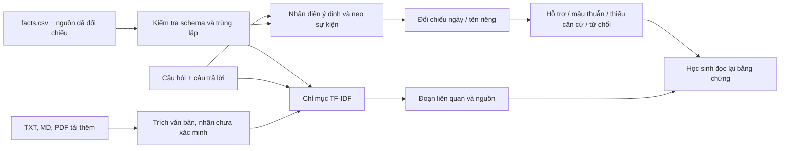

# Báo cáo kỹ thuật FactGuard EDU

Tên học sinh, trường, lớp, giáo viên hướng dẫn: **chủ nhiệm đề tài tự điền**.

# Đề cương nghiên cứu

## Tên đề tài

FactGuard EDU – Nghiên cứu phương pháp kiểm chứng thông tin trong câu trả lời của AI tạo sinh dựa trên bằng chứng phục vụ học tập môn Lịch sử THPT.

Người thực hiện, trường, lớp, giáo viên hướng dẫn: **học sinh điền thông tin thật**. Ngày hoàn thiện bản phần mềm này: 24/10/2026. Hạn 25/10/2026 là mốc do người dùng cung cấp, chưa được đối chiếu với thông báo của ban tổ chức.

## Tính cấp thiết

Câu trả lời trôi chảy không tự chứng minh tính đúng. Với câu hỏi lịch sử có ngày tháng hoặc tên riêng, người học cần xem dữ kiện tham chiếu và nguồn. Dự án xây một công cụ hỗ trợ thao tác đó trên kho nhỏ; chưa tiến hành khảo sát để định lượng mức phổ biến của lỗi AI hay nhu cầu của học sinh.

## Câu hỏi nghiên cứu

Việc sử dụng dữ liệu tham chiếu có nguồn và cơ chế nhận diện thông tin chưa đủ bằng chứng có cải thiện khả năng kiểm chứng so với so khớp từ đơn giản trên bộ kiểm thử được xây dựng hay không?

## Giả thuyết

Trên các câu hỏi dữ kiện đơn thuộc kho, chuẩn hóa ngày/tên và quy tắc đối chiếu có thể phát hiện lỗi thay mốc hoặc tên tốt hơn baseline khớp từ. Câu phức tạp có thể làm tỷ lệ từ chối tăng. Đây là giả thuyết cần kiểm tra, không mặc định đúng trên mọi câu trả lời AI.

## Mục tiêu và phạm vi

- Tạo ứng dụng Windows dễ trình diễn, chạy CPU/offline sau cài đặt.
- Truy xuất đoạn liên quan và hiển thị nguồn rõ ràng.
- Đối chiếu các ngày/năm, nhân vật và địa điểm có đáp án đã kiểm tra.
- Không đồng nhất tương đồng từ với độ đúng; công khai việc chưa thể tự kết luận.
- Đo kết quả bằng chương trình trên dữ liệu có nhãn và công bố các ca thất bại.

Kho khởi tạo gồm 33 dữ kiện Lịch sử Việt Nam 1911–1954. Phạm vi hẹp hơn toàn bộ chương trình THPT. Không giải quyết câu hỏi đánh giá nhân vật, quan hệ nhân quả hoặc tranh luận sử học.

## Phương pháp

Đọc/đối chiếu nguồn chính thức, xây dựng dữ kiện có cấu trúc, truy xuất TF-IDF, đối chiếu quy tắc và thực nghiệm so sánh. Câu trả lời/nhãn là dữ liệu tổng hợp xây dựng có chủ đích. Chưa thu dữ liệu cá nhân, chưa thực hiện nghiên cứu có người tham gia.

## Thiết kế thực nghiệm

Tập phát triển 24 ca, tập đánh giá 87 ca; tách event_id. Kho tham chiếu là nguồn thông tin được phép sử dụng bởi cả hai phương pháp. Cùng một ca được đưa qua baseline và proposed. Có ba nhãn chuẩn: supported, contradicted, insufficient. Đầu ra undetermined được tính sai so với nhãn chuẩn, đồng thời báo riêng tỷ lệ từ chối. Chỉ số: Accuracy, Precision/Recall/F1 theo nhãn và macro, confusion matrix, thời gian xử lý.

Quy tắc/ngưỡng phải được quyết định trước khi dùng kết quả tập đánh giá. Khi phát triển phiên bản mới, tạo một tập đánh giá độc lập mới; không sửa dữ liệu để tăng điểm. Chưa có người gán nhãn thứ hai, chưa đo độ đồng thuận liên đánh giá.

## Kết quả và ứng dụng

Phần mềm và số liệu đo thực tế có trong báo cáo kỹ thuật và reports/experiment. Chênh lệch điểm trên bộ tổng hợp chỉ gợi ý tính khả thi, chưa chứng minh cải thiện năng lực học tập hay tính đúng trên câu trả lời AI ngoài thực tế. Ứng dụng có thể phục vụ buổi thực hành đọc nguồn, dưới hướng dẫn của giáo viên.

## Công việc nghiên cứu tiếp

Giáo viên kiểm tra nguồn và nhãn; bổ sung câu hỏi/đáp án từ nguồn độc lập; nếu tiến hành thử nghiệm học sinh, lập thiết kế nghiên cứu, quy trình đồng ý tham gia và cách bảo vệ dữ liệu phù hợp trước khi thu thập. Chỉ báo cáo những hoạt động và số liệu thực sự đã thực hiện.


---

# Phương pháp và báo cáo kỹ thuật

## Kiến trúc đã triển khai



`loader.py` đọc/kiểm tra CSV và danh mục nguồn. `retriever.py` lập TF-IDF word unigram/bigram, cosine similarity, trả tối đa 4 đoạn; hòa điểm sắp theo ID. `verifier.py` quyết định bằng dữ kiện có cấu trúc và câu hỏi; không dùng câu trả lời để chọn đáp án tham chiếu. `storage.py` ghi SQLite và uploads cục bộ. `evaluator.py` tính chỉ số, CSV/Markdown/JSON. `ui.py` hiển thị sáu trang bằng Streamlit/Plotly.

## Baseline

Chuẩn hóa chữ thường/bỏ dấu; chọn câu hỏi gần nhất theo RapidFuzz token_set_ratio. Nếu điểm câu hỏi và điểm khớp đáp án đều từ 65, dự đoán supported; còn lại insufficient. Không có quy tắc ngày/tên, phủ định hay mâu thuẫn, vì vậy không dự đoán contradicted. Đây là một baseline từ vựng đơn giản và yếu, chưa đủ để so sánh với mọi phương pháp kiểm chứng hiện có. Cùng kho đáp án và cùng tập kiểm thử được dùng cho cả hai phương pháp.

Ngưỡng 65 là hằng số heuristics trong thiết kế trước khi chạy thực nghiệm, không phải xác suất đúng. Không có bước tối ưu ngưỡng theo evaluation.

## Phương pháp đề xuất

1. Tìm đoạn gần câu hỏi bằng TF-IDF để học sinh đọc. Một nhánh tra cứu có cấu trúc nhận diện loại câu hỏi và các nhóm neo (ví dụ Điện Biên Phủ + kết thúc).
2. Cần khớp ít nhất một biến thể trong mỗi nhóm neo và loại thuộc tính được hỏi. Không tìm được dữ kiện chuẩn: insufficient. Câu hỏi mở hoặc nhiều dữ kiện có thể phù hợp: undetermined.
3. Chỉ dùng dữ kiện đã đối chiếu nguồn. Không tự coi tài liệu tải thêm là một đáp án chuẩn.
4. Chuẩn hóa dd/mm/yyyy, dd-mm-yyyy, dd.mm.yyyy và ‘ngày d tháng m năm yyyy’. Câu hỏi năm có thể đối chiếu năm. Đúng năm nhưng thiếu ngày/tháng khi hỏi ngày: insufficient. Sai năm rõ ràng có thể kết luận mâu thuẫn.
5. Tên riêng khớp aliases đã biên soạn; tên thay thế được nhận diện từ các dữ kiện cùng kiểu trong kho. Tên lạ không tự bị coi là sai. Địa danh bao chứa chưa đủ cụ thể không tự bị coi là mâu thuẫn.
6. Phủ định, nhiều mốc, câu nhiều ý hoặc quá 32 từ thường được từ chối. Sau khi trích giá trị, phần còn lại chỉ được chứa từ của câu hỏi và từ nối đơn giản. Có giá trị đúng kèm nội dung lạ: chưa hỗ trợ toàn câu, trả undetermined.
7. Luôn hiển thị dữ kiện dùng quyết định, đoạn bằng chứng và vị trí nguồn. Điểm cosine không tham gia như một xác suất đúng.

Đây là quy tắc từ vựng cho câu trả lời ngắn, chưa có phân tích ngữ nghĩa/quan hệ tổng quát. Thứ tự từ và tiền đề sai trong câu hỏi có thể là nguồn lỗi; cần giới hạn rõ khi trình diễn. Không tự động tách và xác minh hết mọi mệnh đề trong một đoạn tự do.

## Dữ liệu và kiểm soát chất lượng

33 dữ kiện từ 7 URL đã mở/đối chiếu ngày 24/10/2026, với tóm lược tự viết ngắn và vị trí đoạn/trường. Nhãn verified ghi nhận thao tác đối chiếu trực tuyến của trợ lý; chưa đại diện cho hội đồng chuyên gia thẩm định.

111 ca (24 development, 87 evaluation), gồm đúng/sai mốc thời gian, đúng/nhầm nhân vật/địa danh, thiếu thông tin, ngoài tài liệu, biến thể cách viết và phủ định. 87 ca đánh giá gồm 29 câu hỏi phân biệt; không coi 87 ca là 87 quan sát độc lập về người học. Tách theo sự kiện, không trộn các biến thể cùng sự kiện vào hai tập. Kho tri thức có sẵn đáp án sự kiện đánh giá, đúng với nhiệm vụ đối chiếu kho đóng.

Ca ngoài kho có thể chứa kiến thức đúng trên thực tế nhưng vẫn nhãn insufficient vì không có bằng chứng trong kho. Với câu có ý thêm không được hỗ trợ, nhãn chuẩn insufficient. Với phủ định đáp án đúng, nhãn chuẩn contradicted; chương trình có thể trả undetermined và sẽ bị tính sai. Chính sách nhãn này được công bố để tránh che giấu lỗi bằng cách đổi nhãn sau thực nghiệm.

## Chỉ số

- Accuracy = số dự đoán đúng nhãn / toàn bộ ca.
- Precision của nhãn = TP/(TP+FP); Recall = TP/(TP+FN); F1 = trung bình điều hòa Precision và Recall. Mẫu số 0 ghi 0.
- Macro lấy trung bình đều ba nhãn chuẩn, kể cả khi hệ thống không dự đoán một nhãn.
- Confusion matrix bốn cột đầu ra; hàng undetermined bằng 0 vì không dùng làm nhãn chuẩn.
- Tỷ lệ từ chối tự kết luận = undetermined/n.
- Tỷ lệ chưa kết luận đúng/sai = (insufficient + undetermined)/n; insufficient là một kết quả có ý nghĩa trong bài toán thiếu bằng chứng.
- Thời gian từng lời gọi đo perf_counter; ghi mean, median, p95. Không gồm khởi tạo chỉ mục/giao diện, không suy rộng sang phần cứng khác.
- selective_accuracy trong JSON chỉ loại nhãn từ chối undetermined, vẫn giữ insufficient; không được mô tả là tỷ lệ đúng trên mọi câu có kết luận đúng/sai.

## Tái lập và tính trung thực

Không dùng ngẫu nhiên. scripts/reproduce.py chạy hai lần và so dự đoán, không đòi thời gian bằng nhau. JSON lưu Python, thư viện, hệ điều hành và SHA-256 dữ liệu. reports/protocol.json ghi quy tắc/ngưỡng. Sửa lỗi phần mềm được phát hiện bằng unit test được ghi trong nhật ký; không tối ưu theo điểm evaluation.

Kết quả thực tế nằm trong [báo cáo thực nghiệm](experiment/ket_qua_thuc_nghiem.md). Chưa có kiểm định thống kê cho dữ liệu phụ thuộc, chưa so với baseline truy xuất ngữ nghĩa mạnh hơn, chưa thử nghiệm học sinh. Không khẳng định tính mới ở cấp công trình khoa học nếu chưa khảo sát tài liệu liên quan đầy đủ.


---

# Tóm tắt kết quả đo thực tế

87 ca đánh giá / 29 câu hỏi phân biệt. Câu trả lời tổng hợp có chủ đích; chưa có thẩm định nhãn độc lập.

| Phương pháp | Accuracy | F1 macro | Tỷ lệ từ chối tự kết luận |
|---|---:|---:|---:|
| Baseline | 51.72% | 0.4048 | 0.00% |
| Proposed | 93.10% | 0.9657 | 6.90% |

Thời điểm chạy: 2026-10-24T08:58:03+00:00 (UTC). Các ca từ chối được tính sai, không bỏ khỏi mẫu số. Chưa kiểm định hiệu quả học tập hoặc độ chính xác trên dữ liệu ngoài thực tế. Không diễn giải precision 1.0 trên bộ nhỏ là bảo đảm không có false positive.

Báo cáo đầy đủ, từng nhãn, ma trận, nhóm và ca thất bại bên dưới.

# Kết quả thực nghiệm FactGuard EDU

Thời điểm chạy (UTC): 2026-10-24T08:58:03+00:00.
Phiên bản thuật toán: 1.0.0. Tập: evaluation.
Số ca mỗi phương pháp: 87; số câu hỏi phân biệt: 29.

Các câu trả lời kiểm thử do người xây dựng dự án tạo có chủ đích; không phải mẫu thu từ học sinh hay ChatGPT.
Kết quả chỉ mô tả bộ kiểm thử nhỏ và kho tham chiếu hiện tại, chưa chứng minh hiệu quả trên quần thể học sinh.

## So sánh

| Phương pháp | Accuracy | Precision macro | Recall macro | F1 macro | Từ chối tự kết luận | Chưa kết luận đúng/sai | TB (ms) |
|---|---:|---:|---:|---:|---:|---:|---:|
| baseline | 0.5172 | 0.3579 | 0.5152 | 0.4048 | 0.0000 | 0.3448 | 0.915 |
| proposed | 0.9310 | 1.0000 | 0.9349 | 0.9657 | 0.0690 | 0.4023 | 1.452 |

Accuracy tính trên toàn bộ ca; undetermined khác cả ba nhãn chuẩn nên tính là sai.
Macro lấy trung bình ba nhãn chuẩn. Precision/recall/F1 mẫu số 0 được ghi 0.
Từ chối tự kết luận = undetermined/n. Chưa kết luận đúng/sai = (insufficient + undetermined)/n.
Thời gian đo từng lời gọi kiểm chứng, không gồm khởi tạo chỉ mục/giao diện; không phải benchmark phần cứng.

## baseline: theo nhãn

| Nhãn | Precision | Recall | F1 | Support |
|---|---:|---:|---:|---:|
| Có bằng chứng hỗ trợ | 0.4737 | 1.0000 | 0.6429 | 27 |
| Mâu thuẫn với bằng chứng | 0.0000 | 0.0000 | 0.0000 | 27 |
| Chưa đủ bằng chứng | 0.6000 | 0.5455 | 0.5714 | 33 |

Ma trận nhầm lẫn (hàng = nhãn chuẩn; cột = dự đoán):

Thứ tự: supported, contradicted, insufficient, undetermined

```json
[[27, 0, 0, 0], [15, 0, 12, 0], [15, 0, 18, 0], [0, 0, 0, 0]]
```

### Theo nhóm

| Nhóm | Số ca | Accuracy |
|---|---:|---:|
| Biến thể cách viết | 2 | 1.0000 |
| Câu trả lời không đủ thông tin | 25 | 0.5600 |
| Nhầm nhân vật hoặc địa danh | 14 | 0.0000 |
| Nội dung nằm ngoài tài liệu | 8 | 0.5000 |
| Phủ định cần người đọc | 2 | 0.0000 |
| Sai mốc thời gian | 11 | 0.0000 |
| Đúng ngày tháng năm | 11 | 1.0000 |
| Đúng nhân vật hoặc địa danh | 14 | 1.0000 |

### Các ca thất bại: 42

- E002: chuẩn `contradicted`, dự đoán `supported`. Baseline khớp từ với đáp án; chưa phân tích phủ định, quan hệ hay mâu thuẫn.
- E003: chuẩn `insufficient`, dự đoán `supported`. Baseline khớp từ với đáp án; chưa phân tích phủ định, quan hệ hay mâu thuẫn.
- E005: chuẩn `contradicted`, dự đoán `insufficient`. So khớp từ đơn giản không tìm thấy câu trả lời tương ứng.
- E008: chuẩn `contradicted`, dự đoán `supported`. Baseline khớp từ với đáp án; chưa phân tích phủ định, quan hệ hay mâu thuẫn.
- E011: chuẩn `contradicted`, dự đoán `insufficient`. So khớp từ đơn giản không tìm thấy câu trả lời tương ứng.
- E014: chuẩn `contradicted`, dự đoán `supported`. Baseline khớp từ với đáp án; chưa phân tích phủ định, quan hệ hay mâu thuẫn.
- E017: chuẩn `contradicted`, dự đoán `supported`. Baseline khớp từ với đáp án; chưa phân tích phủ định, quan hệ hay mâu thuẫn.
- E018: chuẩn `insufficient`, dự đoán `supported`. Baseline khớp từ với đáp án; chưa phân tích phủ định, quan hệ hay mâu thuẫn.
- E020: chuẩn `contradicted`, dự đoán `supported`. Baseline khớp từ với đáp án; chưa phân tích phủ định, quan hệ hay mâu thuẫn.
- E021: chuẩn `insufficient`, dự đoán `supported`. Baseline khớp từ với đáp án; chưa phân tích phủ định, quan hệ hay mâu thuẫn.
- E023: chuẩn `contradicted`, dự đoán `insufficient`. So khớp từ đơn giản không tìm thấy câu trả lời tương ứng.
- E026: chuẩn `contradicted`, dự đoán `supported`. Baseline khớp từ với đáp án; chưa phân tích phủ định, quan hệ hay mâu thuẫn.
- E027: chuẩn `insufficient`, dự đoán `supported`. Baseline khớp từ với đáp án; chưa phân tích phủ định, quan hệ hay mâu thuẫn.
- E029: chuẩn `contradicted`, dự đoán `supported`. Baseline khớp từ với đáp án; chưa phân tích phủ định, quan hệ hay mâu thuẫn.
- E030: chuẩn `insufficient`, dự đoán `supported`. Baseline khớp từ với đáp án; chưa phân tích phủ định, quan hệ hay mâu thuẫn.
- E032: chuẩn `contradicted`, dự đoán `supported`. Baseline khớp từ với đáp án; chưa phân tích phủ định, quan hệ hay mâu thuẫn.
- E033: chuẩn `insufficient`, dự đoán `supported`. Baseline khớp từ với đáp án; chưa phân tích phủ định, quan hệ hay mâu thuẫn.
- E035: chuẩn `contradicted`, dự đoán `insufficient`. So khớp từ đơn giản không tìm thấy câu trả lời tương ứng.
- E038: chuẩn `contradicted`, dự đoán `insufficient`. So khớp từ đơn giản không tìm thấy câu trả lời tương ứng.
- E041: chuẩn `contradicted`, dự đoán `insufficient`. So khớp từ đơn giản không tìm thấy câu trả lời tương ứng.
- E044: chuẩn `contradicted`, dự đoán `supported`. Baseline khớp từ với đáp án; chưa phân tích phủ định, quan hệ hay mâu thuẫn.
- E045: chuẩn `insufficient`, dự đoán `supported`. Baseline khớp từ với đáp án; chưa phân tích phủ định, quan hệ hay mâu thuẫn.
- E047: chuẩn `contradicted`, dự đoán `supported`. Baseline khớp từ với đáp án; chưa phân tích phủ định, quan hệ hay mâu thuẫn.
- E048: chuẩn `insufficient`, dự đoán `supported`. Baseline khớp từ với đáp án; chưa phân tích phủ định, quan hệ hay mâu thuẫn.
- E050: chuẩn `contradicted`, dự đoán `insufficient`. So khớp từ đơn giản không tìm thấy câu trả lời tương ứng.
- E053: chuẩn `contradicted`, dự đoán `insufficient`. So khớp từ đơn giản không tìm thấy câu trả lời tương ứng.
- E056: chuẩn `contradicted`, dự đoán `supported`. Baseline khớp từ với đáp án; chưa phân tích phủ định, quan hệ hay mâu thuẫn.
- E057: chuẩn `insufficient`, dự đoán `supported`. Baseline khớp từ với đáp án; chưa phân tích phủ định, quan hệ hay mâu thuẫn.
- E059: chuẩn `contradicted`, dự đoán `insufficient`. So khớp từ đơn giản không tìm thấy câu trả lời tương ứng.
- E062: chuẩn `contradicted`, dự đoán `insufficient`. So khớp từ đơn giản không tìm thấy câu trả lời tương ứng.
- E065: chuẩn `contradicted`, dự đoán `insufficient`. So khớp từ đơn giản không tìm thấy câu trả lời tương ứng.
- E068: chuẩn `contradicted`, dự đoán `supported`. Baseline khớp từ với đáp án; chưa phân tích phủ định, quan hệ hay mâu thuẫn.
- E069: chuẩn `insufficient`, dự đoán `supported`. Baseline khớp từ với đáp án; chưa phân tích phủ định, quan hệ hay mâu thuẫn.
- E071: chuẩn `contradicted`, dự đoán `insufficient`. So khớp từ đơn giản không tìm thấy câu trả lời tương ứng.
- E074: chuẩn `contradicted`, dự đoán `supported`. Baseline khớp từ với đáp án; chưa phân tích phủ định, quan hệ hay mâu thuẫn.
- E075: chuẩn `insufficient`, dự đoán `supported`. Baseline khớp từ với đáp án; chưa phân tích phủ định, quan hệ hay mâu thuẫn.
- E100: chuẩn `insufficient`, dự đoán `supported`. Baseline khớp từ với đáp án; chưa phân tích phủ định, quan hệ hay mâu thuẫn.
- E101: chuẩn `insufficient`, dự đoán `supported`. Baseline khớp từ với đáp án; chưa phân tích phủ định, quan hệ hay mâu thuẫn.
- E102: chuẩn `insufficient`, dự đoán `supported`. Baseline khớp từ với đáp án; chưa phân tích phủ định, quan hệ hay mâu thuẫn.
- E103: chuẩn `insufficient`, dự đoán `supported`. Baseline khớp từ với đáp án; chưa phân tích phủ định, quan hệ hay mâu thuẫn.
- E104: chuẩn `contradicted`, dự đoán `supported`. Baseline khớp từ với đáp án; chưa phân tích phủ định, quan hệ hay mâu thuẫn.
- E105: chuẩn `contradicted`, dự đoán `supported`. Baseline khớp từ với đáp án; chưa phân tích phủ định, quan hệ hay mâu thuẫn.

## proposed: theo nhãn

| Nhãn | Precision | Recall | F1 | Support |
|---|---:|---:|---:|---:|
| Có bằng chứng hỗ trợ | 1.0000 | 1.0000 | 1.0000 | 27 |
| Mâu thuẫn với bằng chứng | 1.0000 | 0.9259 | 0.9615 | 27 |
| Chưa đủ bằng chứng | 1.0000 | 0.8788 | 0.9355 | 33 |

Ma trận nhầm lẫn (hàng = nhãn chuẩn; cột = dự đoán):

Thứ tự: supported, contradicted, insufficient, undetermined

```json
[[27, 0, 0, 0], [0, 25, 0, 2], [0, 0, 29, 4], [0, 0, 0, 0]]
```

### Theo nhóm

| Nhóm | Số ca | Accuracy |
|---|---:|---:|
| Biến thể cách viết | 2 | 1.0000 |
| Câu trả lời không đủ thông tin | 25 | 1.0000 |
| Nhầm nhân vật hoặc địa danh | 14 | 1.0000 |
| Nội dung nằm ngoài tài liệu | 8 | 0.5000 |
| Phủ định cần người đọc | 2 | 0.0000 |
| Sai mốc thời gian | 11 | 1.0000 |
| Đúng ngày tháng năm | 11 | 1.0000 |
| Đúng nhân vật hoặc địa danh | 14 | 1.0000 |

### Các ca thất bại: 6

- E100: chuẩn `insufficient`, dự đoán `undetermined`. Câu có phủ định, nhiều mệnh đề hoặc vượt phạm vi quy tắc. Cần người kiểm tra quan hệ giữa các dữ kiện.
- E101: chuẩn `insufficient`, dự đoán `undetermined`. Câu có phủ định, nhiều mệnh đề hoặc vượt phạm vi quy tắc. Cần người kiểm tra quan hệ giữa các dữ kiện.
- E102: chuẩn `insufficient`, dự đoán `undetermined`. Câu có phủ định, nhiều mệnh đề hoặc vượt phạm vi quy tắc. Cần người kiểm tra quan hệ giữa các dữ kiện.
- E103: chuẩn `insufficient`, dự đoán `undetermined`. Câu có phủ định, nhiều mệnh đề hoặc vượt phạm vi quy tắc. Cần người kiểm tra quan hệ giữa các dữ kiện.
- E104: chuẩn `contradicted`, dự đoán `undetermined`. Câu có phủ định, nhiều mệnh đề hoặc vượt phạm vi quy tắc. Cần người kiểm tra quan hệ giữa các dữ kiện.
- E105: chuẩn `contradicted`, dự đoán `undetermined`. Câu có phủ định, nhiều mệnh đề hoặc vượt phạm vi quy tắc. Cần người kiểm tra quan hệ giữa các dữ kiện.

## Khả năng tái lập

Dự đoán xác định, không dùng số ngẫu nhiên. Thời gian có thể thay đổi theo máy/lần chạy.
Kho tri thức chứa đáp án tham chiếu cho các sự kiện được đánh giá: đây là bài toán kiểm chứng trong kho đóng, không phải kiểm tra ghi nhớ của mô hình.
Tách development/evaluation theo event_id. Quy tắc không được điều chỉnh dựa trên điểm evaluation.
Baseline chỉ khớp từ, không có nhãn mâu thuẫn: đây là baseline đơn giản và yếu; chưa so với hệ thống kiểm chứng tiên tiến.
Cần bộ đánh giá độc lập do giáo viên gán nhãn, mở rộng dữ liệu và nghiên cứu người dùng trước khi suy rộng.

## Môi trường

```json
{
  "python": "3.12.10",
  "platform": "Windows-11-10.0.26200-SP0",
  "packages": {
    "streamlit": "1.66.1",
    "pandas": "3.0.6",
    "scikit-learn": "1.9.1",
    "rapidfuzz": "3.14.6",
    "pypdf": "6.21.2",
    "plotly": "6.9.0"
  }
}
```


---

# Giới hạn và hướng phát triển

## Giới hạn hiện tại

1. Kho chỉ có 33 dữ kiện thuộc một số sự kiện 1911–1954; không đại diện toàn bộ Lịch sử THPT.
2. Nguồn đã được mở/đối chiếu bởi trợ lý, chưa có giáo viên thẩm định. Nguồn chính thức vẫn có thể có lỗi đánh máy; đã phát hiện chú thích ‘2945’ ở S02 và dùng phần văn xuôi 1945 có ngữ cảnh.
3. Dữ liệu trả lời và nhãn do trợ lý tự xây dựng từ dữ kiện; chưa có gán nhãn độc lập, độ đồng thuận hoặc câu trả lời thu thực tế từ LLM/học sinh. Điểm cao trên tập tổng hợp không bảo đảm ứng dụng ngoài thực tế.
4. Câu hỏi được nhận diện bằng kiểu và neo từ vựng. Không có parser quan hệ/chủ thể tổng quát; câu hỏi đổi tiền đề, đảo quan hệ hoặc diễn đạt mới có thể chưa được xử lý đúng. Người dùng cần đặt câu hỏi ngắn, chính xác và đọc lại nguồn.
5. Câu trả lời chỉ kiểm tra một thuộc tính được hỏi. Chưa tự tách mọi mệnh đề; phủ định, nhiều thời điểm, lập luận và suy diễn thường bị từ chối. Không công bố ‘toàn bộ câu trả lời đã đúng’.
6. Tên riêng phụ thuộc aliases và danh sách trong kho. Địa danh lịch sử, thay đổi tên hành chính, đồng danh hoặc tên ngoài danh sách có thể không nhận diện được.
7. TF-IDF là truy xuất từ vựng, có thể bỏ sót từ đồng nghĩa hoặc đưa đoạn liên quan hời hợt. Điểm tương đồng không chứng minh sự thật.
8. Baseline không có nhãn mâu thuẫn nên là đối chứng yếu. Chênh lệch không chứng minh vượt mọi hệ thống khác. Chưa có ablation tách đóng góp truy xuất, chuẩn hóa và quy tắc.
9. PDF chỉ trích văn bản, chưa OCR; trang không có text trong PDF hỗn hợp có thể bị bỏ qua. Cần kiểm tra đủ nội dung trước khi dùng. Giới hạn 5 MB và 100 trang.
10. Uploads chưa xác minh chỉ dùng tìm đoạn; chưa có giao diện thẩm định/chỉnh sửa trực tiếp facts.csv. Thêm đáp án chuẩn cần sửa file theo hướng dẫn và kiểm thử lại.
11. SQLite và tệp JSON phục vụ một máy; chưa có đăng nhập, mã hóa, chia sẻ nhóm, quản trị phiên bản dữ kiện hay dịch vụ Internet công cộng.
12. Chưa có bằng chứng cải thiện tư duy phản biện, điểm học tập hoặc giảm tin sai của học sinh; các tác động này cần nghiên cứu có người tham gia.

## Những phần chủ động chưa tích hợp

LLM sinh văn bản, mô hình Transformer/NLI, GPU, API trả phí, OCR, quét web tự động trong ứng dụng, ứng dụng .exe độc lập, đăng nhập và triển khai cloud. Chúng không cần cho bản trình diễn offline và không được mô tả là đã hoàn thành.

## Hướng phát triển có thể kiểm tra

- Giáo viên kiểm tra nguồn và cùng người gán nhãn thứ hai chuẩn hóa nhãn, đo độ đồng thuận.
- Xây tập đánh giá mới, câu hỏi được diễn đạt độc lập, có nhiều nguồn và nhiều kiểu sai.
- Thêm baseline mạnh hơn, tách thử nghiệm từng thành phần và đo truy xuất riêng.
- Kiểm tra tiền đề câu hỏi, trích quan hệ và nhiều mệnh đề; chỉ dùng mô hình mới khi đo được lợi ích trên tập chưa xem.
- Nghiên cứu người dùng có thiết kế/đồng ý phù hợp, đánh giá khả năng trích nguồn và tự kiểm chứng thay vì chỉ khảo sát mức hài lòng.


---

# Nguồn dữ liệu đã đối chiếu

Ngày kiểm tra trực tuyến: 24/10/2026.
Tất cả URL dưới đây đã được mở và đọc bằng công cụ web trong phiên xây dựng; không dùng URL chỉ tìm thấy nhưng mở lỗi.
Bản cục bộ là tóm lược tự biên soạn, không phải nguyên văn. Cần giáo viên/học sinh thẩm định lại trước khi nộp.

## S01. Ký ức không phai về ngày 02/9/1945 ở Sài Gòn – Gia Định

- Cơ quan: Bảo tàng Thành phố Hồ Chí Minh.
- Ngày đăng/ban hành: 2024-09-01.
- [Đọc trang gốc](https://hcmc-museum.edu.vn/luu-tru/4844).
- Đối chiếu ngày: 2026-10-24.
- Cách kiểm tra: Mở trang gốc và đối chiếu nội dung bằng công cụ web; chưa có thẩm định độc lập của giáo viên.
- Tóm lược cục bộ: data/sources/S01.md; vị trí từng dữ kiện: data/facts.csv.

## S02. Tổng khởi nghĩa Cách mạng tháng Tám năm 1945

- Cơ quan: Bảo tàng Lịch sử Quốc gia.
- Ngày đăng/ban hành: 2015-08-18.
- [Đọc trang gốc](https://baotanglichsuquocgia.vn/vi/Articles/3097/18473/tong-khoi-nghia-cach-mang-thang-tam-nam-1945.html).
- Đối chiếu ngày: 2026-10-24.
- Cách kiểm tra: Mở trang gốc và đối chiếu nội dung bằng công cụ web; chưa có thẩm định độc lập của giáo viên.
- Tóm lược cục bộ: data/sources/S02.md; vị trí từng dữ kiện: data/facts.csv.

## S03. Một quyết định mang tính lịch sử của Đại tướng Võ Nguyên Giáp

- Cơ quan: Bảo tàng Lịch sử Quốc gia.
- Ngày đăng/ban hành: 2014-03-20.
- [Đọc trang gốc](https://baotanglichsuquocgia.vn/vi/Articles/3096/15973/mot-quyet-djinh-mang-tinh-lich-su-cua-djai-tuong-vo-nguyen-giap.html).
- Đối chiếu ngày: 2026-10-24.
- Cách kiểm tra: Mở trang gốc và đối chiếu nội dung bằng công cụ web; chưa có thẩm định độc lập của giáo viên.
- Tóm lược cục bộ: data/sources/S03.md; vị trí từng dữ kiện: data/facts.csv.

## S04. Kỷ niệm 84 năm thành lập Đảng Cộng sản Việt Nam – Con dấu của Đảng Cộng sản Đông Dương

- Cơ quan: Bảo tàng Lịch sử Quốc gia.
- Ngày đăng/ban hành: 2014-01-31.
- [Đọc trang gốc](https://baotanglichsu.vn/VI/Articles/3097/15722/ky-niem-84-nam-thanh-lap-djang-cong-san-viet-nam-3-2-1930-3-2-2014-con-dau-cua-djang-cong-san-djong-duong.html).
- Đối chiếu ngày: 2026-10-24.
- Cách kiểm tra: Mở trang gốc và đối chiếu nội dung bằng công cụ web; chưa có thẩm định độc lập của giáo viên.
- Tóm lược cục bộ: data/sources/S04.md; vị trí từng dữ kiện: data/facts.csv.

## S05. Sắc lệnh số 76: hoãn cuộc tổng tuyển cử đến ngày 6-1-1946

- Cơ quan: Cổng Thông tin điện tử Chính phủ.
- Ngày đăng/ban hành: 1945-12-18.
- [Đọc trang gốc](https://chinhphu.vn/default.aspx?docid=511&pageid=27160).
- Đối chiếu ngày: 2026-10-24.
- Cách kiểm tra: Mở trang gốc và đối chiếu nội dung bằng công cụ web; chưa có thẩm định độc lập của giáo viên.
- Tóm lược cục bộ: data/sources/S05.md; vị trí từng dữ kiện: data/facts.csv.

## S06. Kỷ niệm 100 năm Ngày Bác Hồ ra đi tìm đường cứu nước

- Cơ quan: Báo Điện tử Chính phủ.
- Ngày đăng/ban hành: 2011-06-06.
- [Đọc trang gốc](https://baochinhphu.vn/ky-niem-100-nam-ngay-bac-ho-ra-di-tim-duong-cuu-nuoc-5-6-1911-5-6-2011-nguoi-tao-nen-buoc-ngoat-lich-su-cho-cach-mang-viet-nam-10281639.htm).
- Đối chiếu ngày: 2026-10-24.
- Cách kiểm tra: Mở trang gốc và đối chiếu nội dung bằng công cụ web; chưa có thẩm định độc lập của giáo viên.
- Tóm lược cục bộ: data/sources/S06.md; vị trí từng dữ kiện: data/facts.csv.

## S07. Hội nghị lần thứ VIII Ban Chấp hành Trung ương Đảng

- Cơ quan: Bảo tàng Lịch sử Quốc gia.
- Ngày đăng/ban hành: 2013-05-20.
- [Đọc trang gốc](https://baotanglichsu.vn/vi/Articles/3097/14317/hoi-nghi-lan-thu-viii-ban-chap-hanh-trung-uong-djang-va-quyet-djinh-tien-hanh-cong-cuoc-giai-phong-dan-toc-tu-ngay-10-djen-ngay-19-5-1941.html).
- Đối chiếu ngày: 2026-10-24.
- Cách kiểm tra: Mở trang gốc và đối chiếu nội dung bằng công cụ web; chưa có thẩm định độc lập của giáo viên.
- Tóm lược cục bộ: data/sources/S07.md; vị trí từng dữ kiện: data/facts.csv.

## Tài liệu kỹ thuật đã tham khảo

- [Streamlit AppTest](https://docs.streamlit.io/1.54.0/develop/api-reference/app-testing/st.testing.v1.apptest): kiểm tra luồng ứng dụng.
- [scikit-learn classification_report](https://scikit-learn.org/stable/modules/generated/sklearn.metrics.classification_report.html): chỉ số theo nhãn và quy ước zero_division.

Các tài liệu kỹ thuật không phải nguồn dữ kiện lịch sử. Không liệt kê nghiên cứu hay tài liệu chưa đọc như thể đã tham khảo.


---

