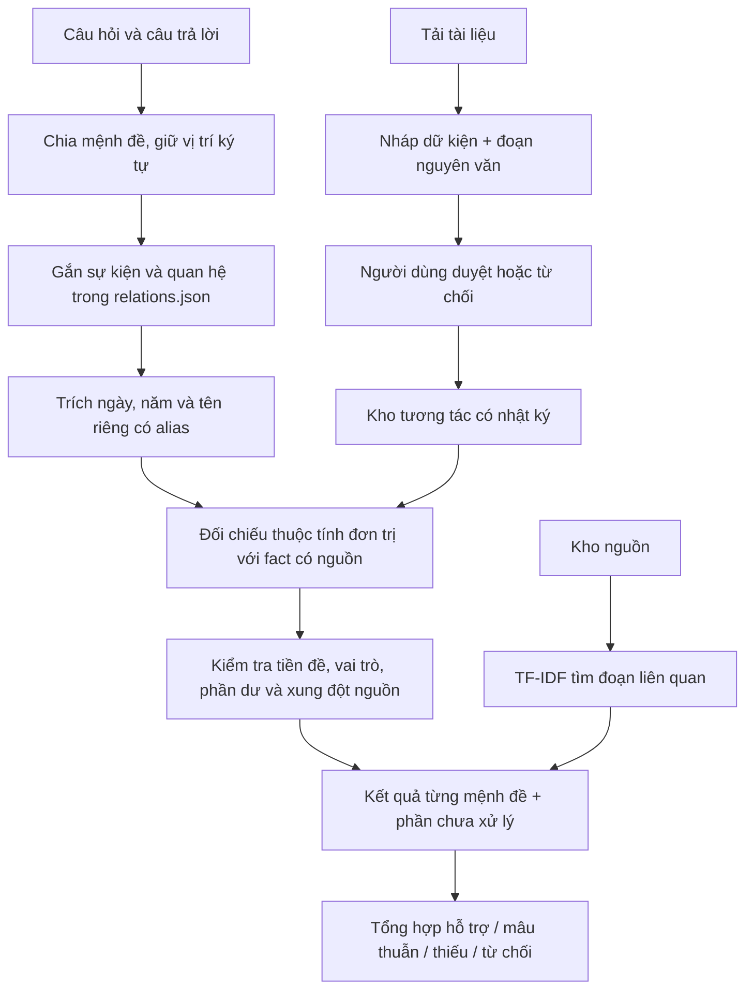

# Báo cáo kỹ thuật và nghiên cứu FactGuard EDU v2

Người thực hiện, trường, lớp và người hướng dẫn: **tự điền thông tin thật**.

# FactGuard EDU v2: kiểm chứng mệnh đề theo quan hệ và quản lý phần chưa có căn cứ

## Tóm tắt

Phiên bản nghiên cứu chuyển từ đối chiếu một đáp án ngắn sang trích các mệnh đề có cấu trúc trong câu trả lời. Mỗi giá trị được gắn với sự kiện, quan hệ, loại thuộc tính, phạm vi ký tự và dữ kiện nguồn. Khi câu có cả phần đúng và phần sai, các kết quả được hiển thị riêng; nội dung chưa gắn được với quan hệ được giữ lại như phần chưa xử lý.

Đây là một nghiên cứu thực nghiệm phần mềm trên kho đóng, ngữ pháp hữu hạn và dữ liệu tổng hợp. Chưa tiến hành nghiên cứu người học, chưa có giáo viên thẩm định độc lập hoặc chứng minh thuật toán mới ở cấp lĩnh vực. Không sử dụng số liệu người dùng giả.

## 1. Vấn đề nghiên cứu và giả thuyết

**Câu hỏi:** Tách mệnh đề và ràng buộc quan hệ/phạm vi/nguồn có giảm kết luận hỗ trợ sai khi câu trả lời chứa nhiều dữ kiện, so với đối chứng từ vựng ba nhãn và một cấu hình bỏ chốt phạm vi hay không?

- Giả thuyết về khả năng xử lý: bộ trích nhiều mệnh đề có thể đối chiếu ngày, nhân vật và địa điểm trong cùng câu thay vì coi một giá trị đúng là toàn đoạn đúng.
- Giả thuyết về kiểm soát lỗi: chốt tiền đề, vai trò và nội dung dư có thể giảm hỗ trợ sai; đổi lại có thể giảm mức bao phủ kết luận đúng/sai.
- Chưa có giả thuyết được kiểm nghiệm về cải thiện điểm học tập hoặc tư duy phản biện của học sinh.

Các cấu hình, chỉ số và phép lấy mẫu lại đã được ghi trong research_protocol_v2.json trước khi tạo bộ thử thách. Đây là đóng băng cục bộ, không phải đăng ký nghiên cứu công khai hoặc đánh giá độc lập.

## 2. Cơ sở và vị trí đóng góp

FEVER tổ chức bài toán theo nhãn hỗ trợ, bác bỏ, thiếu thông tin, gắn với bằng chứng; nghiên cứu này tham khảo cách tách nhãn và căn cứ, không dùng bộ tiếng Anh đó để so điểm với dữ liệu Việt Nam. [Thorne và cộng sự, 2018](https://aclanthology.org/N18-1074/).

Selective classification nghiên cứu đánh đổi giữa mức bao phủ và rủi ro khi cho phép từ chối. Bản này chỉ đo mức bao phủ/rủi ro quan sát được của các quy tắc; không triển khai bộ hiệu chỉnh hoặc bảo đảm rủi ro xác suất của nghiên cứu mạng nơ-ron. [Geifman và El-Yaniv, 2017](https://arxiv.org/abs/1705.08500).

Đối chứng học máy dùng LogisticRegression trong scikit-learn, với đặc trưng chỉ dựa trên từ vựng và tham số cố định. [Tài liệu chính thức](https://scikit-learn.org/stable/modules/generated/sklearn.linear_model.LogisticRegression.html).

**Đóng góp đã thực hiện ở phạm vi dự án:**

1. Một bộ kiểm chứng có giải thích cho các quan hệ lịch sử được khai báo, đối chiếu nhiều giá trị với nguồn và vị trí ký tự thực trong câu trả lời.
2. Một cơ chế không bỏ qua phần văn bản chưa được xác minh, chặn một số tiền đề và vai trò sai; giữ khả năng từ chối.
3. Luồng quản lý nguồn từ bản nháp tới duyệt/thu hồi có lịch sử phiên bản, không tự chuyển PDF tải lên thành chân lý.
4. Bộ thực nghiệm có đối chứng ba nhãn, ablation, đo lỗi hỗ trợ sai và nguồn bằng chứng, tách dữ liệu tổng hợp với ca người dùng nhập và nhãn tự thẩm định.

Không khẳng định TF-IDF, luật ngày tháng, Logistic Regression, hash chain hoặc ba nhãn là phát minh mới của dự án.

## 3. Mô hình dữ liệu và thuật toán



### 3.1. Ràng buộc quan hệ

Một mệnh đề gồm sự kiện, quan hệ và thuộc tính. Ví dụ `dbp.start/date` và `dbp.end/date` là hai thuộc tính khác nhau: không được dùng ngày kết thúc để hỗ trợ ngày bắt đầu. Có 23 mẫu quan hệ trong data/relations.json, ánh xạ tới 33 dữ kiện nguồn.

Nhận diện cần các nhóm neo, không chỉ một tên sự kiện. Mẫu cụ thể hơn chỉ thay mẫu rộng trong cùng sự kiện; nhiều quan hệ chưa tách được dẫn tới từ chối. Câu ngắn không nêu sự kiện có thể kế thừa một quan hệ duy nhất từ câu hỏi. Câu hỏi có tiền đề sai hoặc địa điểm chưa xác minh được chặn trước khi dùng nó làm ngữ cảnh.

### 3.2. Trích giá trị và giữ dấu vết

Chuẩn hóa có bản đồ vị trí giữa chuỗi bỏ dấu và văn bản gốc. Mỗi check lưu span_start/span_end; cắt văn bản gốc ở đúng khoảng đó cho ra observed. Tên được gom theo tập alias giao nhau có khai báo; không dùng fuzzy để đồng nhất hai nhân vật gần giống tên. Ngày được chuẩn hóa; năm đơn có độ chi tiết khác ngày đầy đủ.

Một câu chứa nhân vật, ngày và nơi có thể sinh ba check, dùng ba fact_id và ba căn cứ. Giá trị đúng/sai hiển thị riêng, không có phần trăm tin cậy tùy ý. Cơ chế vai trò mới chỉ kiểm tra một số mẫu nhân vật/địa điểm theo vị trí từ; chưa phải bộ phân tích ngữ nghĩa tiếng Việt tổng quát.

### 3.3. Phủ định và phần chưa xử lý

Xử lý phủ định đơn trên một thuộc tính đơn trị, ví dụ ‘không phải ngày X mà là ngày Y’. Nếu X là đáp án đúng mà bị phủ định thì có mâu thuẫn; nếu X khác và Y đúng thì hai mệnh đề có thể được hỗ trợ. Phủ định tác động nhiều kiểu thuộc tính vẫn cần người đọc.

Các từ và ý ngoài mẫu sau khi trích giá trị được giữ ở danh sách issues. Có suy đoán, quan hệ thời gian chưa mô hình hóa, câu không gắn được với sự kiện, vai trò đảo hoặc nội dung thêm thì không tự xác nhận toàn đoạn. Nếu có một mệnh đề mâu thuẫn rõ, tổng thể báo mâu thuẫn và vẫn liệt kê phần chưa xử lý. Nếu không có mâu thuẫn nhưng chưa đủ căn cứ, trả insufficient hoặc undetermined.

## 4. Module quản trị nguồn có giá trị sử dụng

Người dùng tải tài liệu → chọn đoạn có thật → lập câu hỏi, đáp án chuẩn, nhóm neo → lưu nháp. Giá trị ngày/tên phải xuất hiện trong đoạn bằng chứng; đáp án hiển thị phải khớp giá trị chuẩn. Nguồn mới chỉ có hiệu lực sau thao tác duyệt có người duyệt, căn cứ và xác nhận đã đọc nguồn.

Mỗi lần duyệt/từ chối/thu hồi lưu phiên bản, thời điểm, bản chụp văn bản và SHA-256. Chuỗi hash cục bộ cùng kiểm tra bản ghi cuối giúp phát hiện thay đổi ngoài luồng; không có xác thực danh tính, chữ ký số hay chống sửa toàn bộ DB. Người duyệt là tự khai, không tự được gọi là giáo viên có chứng nhận.

Thu hồi làm dữ kiện ngừng tham gia kiểm chứng ngay ở lần nạp tiếp theo. Kho do người dùng bổ sung được tách khỏi kho cố định trong thực nghiệm, tránh một lần tải PDF làm đổi điều kiện đo.

## 5. Thiết kế thực nghiệm

### Dữ liệu

- Kho có nguồn: 33 dữ kiện, 7 trang đã đối chiếu trực tuyến; chưa có thẩm định độc lập.
- Development: 24 ca thuộc ba sự kiện của v1, dùng huấn luyện đối chứng ba nhãn. Không dùng nhãn evaluation để fit hoặc chọn tham số.
- Evaluation v1: 87 ca đã được xem trước đó, chỉ giữ làm hồi quy; không gọi là tập chưa biết của v2.
- Challenge v2: 46 ca, 10 cụm sự kiện, 16 supported, 17 contradicted, 13 insufficient. Có 62 mệnh đề giá trị chuẩn và hai ca rút bằng chứng khỏi kho. Tạo sau khi đóng băng mã, nhưng cùng trợ lý thiết kế mã và dữ liệu nên **không độc lập**.
- Ca người dùng: ban đầu chưa có dữ liệu thật. Được nhập riêng, lưu nguồn gốc và thời điểm; không tự điền nhãn.

Các biến thể cùng sự kiện không được coi là quan sát độc lập. Các ca nguồn bị rút dùng cùng kho bị rút cho mọi phương pháp. Chỉ mục đo là các dữ kiện, loại bản tóm lược toàn trang để tránh vô tình vẫn truy xuất sự kiện đã rút qua đoạn tổng quan.

### Bốn cấu hình

| Cấu hình | Thành phần thực sự chạy |
|---|---|
| lexical_3way | TF-IDF ký tự 3–5, sáu đặc trưng từ vựng, StandardScaler + LogisticRegression ba nhãn; C=1, class_weight=balanced; chỉ fit development |
| rules_single_v1 | Giữ nguyên luật một dữ kiện của phiên bản đầu |
| claims_no_guard | Bộ trích mệnh đề v2, bỏ chốt tiền đề/vai trò/nội dung dư; vẫn giữ đối chiếu giá trị và kiểm tra nguồn |
| claims_guarded | Bộ trích và đầy đủ các chốt |

Ablation kiểm tra tác dụng của một nhóm chốt, chưa tách riêng đóng góp từng chốt. Đối chứng được huấn luyện chỉ bằng tập tổng hợp rất nhỏ; không đại diện cho mô hình NLI/LLM mạnh. V1 được thiết kế cho câu hỏi một thuộc tính nên bộ đoạn nhiều dữ kiện/chỉ dẫn chung vượt giao diện đầu vào ban đầu của nó: điểm thấp ở v2 không chứng minh v1 kém ở mọi nhiệm vụ.

### Chỉ số

Accuracy và F1 macro ba nhãn; undetermined vẫn tính sai. Hỗ trợ sai lấy mẫu số là tổng ca không có nhãn supported. Coverage chỉ gồm supported/contradicted; risk là tỷ lệ sai trong các ca đó. Đúng nhãn + đủ bằng chứng yêu cầu các fact_id chuẩn được quy trách nhiệm trực tiếp, không chỉ xuất hiện tình cờ trong top-k.

Đo riêng recall/precision trích giá trị, recall đúng nhãn mệnh đề và recall@4 trước tra cứu có cấu trúc. Không dùng kết quả của bộ trích để tự tạo gold. Thời gian mean/median/p95 đo bằng perf_counter, không gồm dựng giao diện.

Bootstrap cặp theo 10 cụm sự kiện, cùng trọng số mỗi cụm, 2.000 lần, seed cố định. Khoảng 95% có tính thăm dò trên tập tổng hợp được tác giả chọn, không đại diện cho quần thể người học hay mọi sự kiện. Không công bố bảo đảm rủi ro vì chưa quan sát thấy lỗi trên một mẫu nhỏ.

## 6. Kết quả thật và phân tích lỗi

Kết quả chi tiết được tạo bằng code trong [báo cáo đo v2](research_v2/bao_cao_nghien_cuu.md), [CSV](research_v2/results.csv) và [manifest](research_v2/latest.json). Không chép số liệu từ kế hoạch hoặc hình minh họa vào kết quả.

Bốn ca đầy đủ chốt chưa đạt nhãn chuẩn:

- R007: phủ định tác động nhiều thuộc tính, hệ thống từ chối thay vì nhãn contradicted.
- R009/R010: tiền đề sai/chưa xác minh trong câu hỏi; hệ thống từ chối thay vì nhãn insufficient của bộ tác giả.
- R018: vế thứ hai lược chủ ngữ/sự kiện; chưa có bộ giải đồng tham chiếu nên chưa đối chiếu đủ.

Giữ nguyên các ca này sau khi xem điểm, không đổi nhãn để làm đẹp accuracy. Mã lõi và dữ liệu tham chiếu vẫn khớp bản đóng băng.

### Phân tích bổ sung về dạng câu hỏi

Sau khi xem kết quả chính, phát hiện chỉ dẫn chung khác dạng câu hỏi của tập development đối chứng. Vì vậy đã chạy **phân tích hậu nghiệm**: thay chỉ dẫn chung bằng câu hỏi chuẩn ở 34/46 ca phù hợp, giữ đáp án và nhãn. Đối chứng từ vựng tăng từ 17 lên 21 ca đúng, v1 tăng từ 1 lên 13; bản đầy đủ vẫn 42/46. Điều này cho thấy dạng câu hỏi là yếu tố ảnh hưởng đáng kể và phải báo cáo.

Phân tích hậu nghiệm được lưu riêng ở research_v2/format_control, không thay kết quả chính, không gọi là bộ độc lập. Cần bộ dữ liệu do người khác viết và nhiều dạng đầu vào để kết luận chắc hơn.

## 7. Luồng thu thập và gán nhãn thật

Phòng nghiên cứu có phiếu ẩn dự đoán/nhãn tạo sẵn trong màn hình. Người dùng có thể thêm câu trả lời nguyên bản, ghi nguồn gốc, người thu thập và sự kiện. Nhãn được lưu khi người thật nhập, có ghi chú và ID bằng chứng. Độ đồng thuận chỉ tính trên nội dung giống hệt được hai tên khác nhau gán nhãn; kappa để trống khi không xác định.

Ca người dùng chỉ được đưa vào phép đo nhãn đồng thuận sau ít nhất hai tên gán cùng nhãn. Bất đồng hoặc thiếu người được giữ chờ, không tự lấy đa số nhãn máy. Những tên tự khai không chứng minh độc lập/danh tính; cần tổ chức người gán nhãn thật và quy trình riêng nếu muốn công bố nghiên cứu độc lập.

Phép đo ca người dùng chỉ có chuẩn nhãn toàn câu, nên không tự tạo chuẩn mệnh đề/bằng chứng từ đầu ra mô hình. Kết quả này lưu riêng trong runtime, không trộn với challenge tổng hợp. Chưa có dữ liệu người dùng thật tại lúc bàn giao, nên chưa có kết quả thực nghiệm người dùng được công bố.

## 8. Giới hạn và bước tiếp theo

Ngữ pháp hữu hạn, chưa có phân tích quan hệ tổng quát, đồng tham chiếu hoặc phủ định phức tạp. Nguồn nhỏ và có thể còn lỗi; aliases chưa bao phủ cách diễn đạt rộng. Hai mươi ba mẫu quan hệ là kiến thức được biên soạn, không phải mô hình tự học toàn bộ lịch sử. Các ca thực nghiệm có thiên lệch cùng tác giả, đối chứng nhỏ và thiếu nghiên cứu người học.

Ưu tiên tiếp: người hướng dẫn đọc/duyệt nguồn và tổ chức gán nhãn thật; thu bộ mới khác tác giả và kiểu diễn đạt; thêm đối chứng mạnh hơn; tách từng chốt trong ablation; đánh giá mệnh đề có đồng tham chiếu trên tập mới chưa xem. Không đổi thuật toán theo điểm của bộ v2 rồi báo cáo như đánh giá chưa biết.


---

# Nghiên cứu kiểm chứng mệnh đề FactGuard EDU v2

Lần chạy: 2026-10-24T09:55:12+00:00 (UTC).
46 ca/phương pháp; 10 cụm sự kiện; 4 phương pháp.
**Dữ liệu tổng hợp do trợ lý xây dựng, chưa gán nhãn độc lập. Không phải kết quả nghiên cứu học sinh.**

## Câu hỏi nghiên cứu

Tách mệnh đề và chặn quan hệ/phạm vi chưa rõ có giảm kết luận hỗ trợ sai trên bộ thử thách này không?

## Đối chứng và ablation

- lexical_3way: TF-IDF ký tự và 6 đặc trưng từ vựng, StandardScaler + LogisticRegression, học ba nhãn chỉ trên 24 ca development v1.
- rules_single_v1: luật một dữ kiện của bản đầu, giữ nguyên.
- claims_no_guard: bộ trích mệnh đề v2, tắt chốt tiền đề câu hỏi và nội dung dư; vẫn kiểm tra giá trị và tính hợp lệ nguồn.
- claims_guarded: đầy đủ bộ trích, đối chiếu, chốt tiền đề/vai trò và theo dõi phần chưa xử lý.

| Phương pháp | Accuracy | F1 macro | Hỗ trợ sai / ca không được hỗ trợ | Kết luận đúng/sai | Rủi ro trên ca có kết luận | Đúng nhãn + đủ bằng chứng |
|---|---:|---:|---:|---:|---:|---:|
| lexical_3way | 0.3696 | 0.1858 | 0.0667 | 1.0000 | 0.6304 | 0.0217 |
| rules_single_v1 | 0.0217 | 0.0476 | 0.0333 | 0.0217 | 1.0000 | 0.0217 |
| claims_no_guard | 0.8696 | 0.8539 | 0.1667 | 0.8043 | 0.1351 | 0.8478 |
| claims_guarded | 0.9130 | 0.9391 | 0.0000 | 0.6739 | 0.0000 | 0.9130 |

Accuracy tính mọi ca; undetermined vẫn tính sai. Coverage chỉ tính supported/contradicted; risk là tỷ lệ sai trong các ca đó.
Hỗ trợ sai = số ca dự đoán supported khi nhãn chuẩn khác supported / tổng ca nhãn chuẩn khác supported.
Đúng nhãn + đủ bằng chứng yêu cầu tập ID dữ kiện chuẩn nằm trong dữ kiện được phương pháp quy trách nhiệm; không tính các đoạn truy xuất ngẫu nhiên như đã kiểm chứng.

## Phân tích từng giai đoạn

| Phương pháp | Recall trích giá trị | Recall đúng nhãn mệnh đề | Precision trích giá trị | Thời gian TB / median / p95 (ms) |
|---|---:|---:|---:|---:|
| lexical_3way | 0.0000 | 0.0000 | không xác định | 1.927 / 1.870 / 2.441 |
| rules_single_v1 | 0.0000 | 0.0000 | 0.0000 | 1.013 / 0.966 / 1.301 |
| claims_no_guard | 0.9677 | 0.9677 | 0.9231 | 3.739 / 3.730 / 5.457 |
| claims_guarded | 0.9677 | 0.9677 | 0.9836 | 4.212 / 4.374 / 6.098 |

Recall@4 trung bình của truy xuất từ vựng trước tra cứu có cấu trúc: 0.9861. Chỉ tính ca có ID bằng chứng chuẩn.
Những ca nguồn bị rút khỏi kho làm phép thử mất bằng chứng; mọi phương pháp đều dùng cùng kho bị rút của ca đó.
Các đối chứng không có bộ trích mệnh đề không được diễn giải điểm trích bằng 0 là lỗi phân loại; đó là khả năng không triển khai ở phương pháp đó.

## Khoảng biến thiên theo cụm sự kiện

```json
{
  "first": "claims_guarded",
  "second": "lexical_3way",
  "n_clusters": 10,
  "estimate": 0.5528571428571428,
  "lower": 0.48571428571428577,
  "upper": 0.6599999999999999,
  "replicates": 2000,
  "seed": 20261024,
  "estimand": "Mean paired accuracy difference with equal weight per event cluster",
  "caution": "Mô tả thăm dò trên số ít cụm tổng hợp; không suy rộng tới người học hay mọi câu trả lời AI."
}
```
Bootstrap cặp 2.000 lần, cùng trọng số cho từng cụm sự kiện, seed cố định. Khoảng này có tính thăm dò trên số ít cụm do tác giả chọn; không phải bảo đảm xác suất cho câu trả lời mới hay kết luận tác động giáo dục.

## lexical_3way: theo nhóm

| Nhóm | Số ca | Accuracy |
|---|---:|---:|
| Câu sự kiện đầy đủ | 5 | 0.0000 |
| Hoán đổi mốc giữa quan hệ | 2 | 1.0000 |
| Hoán đổi địa phương | 2 | 1.0000 |
| Không xác định dữ kiện | 1 | 0.0000 |
| Nhiều dữ kiện đúng | 4 | 0.0000 |
| Nhiều mốc khác quan hệ | 2 | 0.0000 |
| Nhân vật trong câu đầy đủ | 4 | 0.5000 |
| Nhầm địa điểm | 1 | 1.0000 |
| Nội dung thêm ngoài nguồn | 2 | 0.0000 |
| Phủ định phức tạp | 1 | 1.0000 |
| Phủ định đơn | 2 | 0.5000 |
| Sai ngày cùng năm | 2 | 1.0000 |
| Suy luận ngoài phạm vi | 1 | 0.0000 |
| Sự kiện ngoài kho | 2 | 0.0000 |
| Thiếu dữ kiện để đối chiếu | 1 | 0.0000 |
| Thu hồi bằng chứng | 2 | 0.0000 |
| Tiền đề câu hỏi sai | 2 | 0.0000 |
| Đúng một phần | 6 | 1.0000 |
| Đồng tham chiếu lược chủ ngữ | 1 | 0.0000 |
| Đổi vai trò trong câu | 1 | 0.0000 |
| Độ chi tiết thời gian | 2 | 0.0000 |

Chỉ số từng nhãn:

```json
{
  "supported": {
    "precision": 0.0,
    "recall": 0.0,
    "f1-score": 0.0,
    "support": 16.0
  },
  "contradicted": {
    "precision": 0.38636363636363635,
    "recall": 1.0,
    "f1-score": 0.5573770491803278,
    "support": 17.0
  },
  "insufficient": {
    "precision": 0.0,
    "recall": 0.0,
    "f1-score": 0.0,
    "support": 13.0
  }
}
```

Ma trận (hàng chuẩn/cột dự đoán, thứ tự supported, contradicted, insufficient, undetermined):

```json
[[0, 16, 0, 0], [0, 17, 0, 0], [2, 11, 0, 0], [0, 0, 0, 0]]
```

### Các ca sai hoặc từ chối

- R001: chuẩn supported, dự đoán contradicted. Đối chứng Logistic Regression ba nhãn dựa trên đặc trưng từ vựng; chưa phân tích quan hệ hay mệnh đề.
- R005: chuẩn supported, dự đoán contradicted. Đối chứng Logistic Regression ba nhãn dựa trên đặc trưng từ vựng; chưa phân tích quan hệ hay mệnh đề.
- R008: chuẩn insufficient, dự đoán contradicted. Đối chứng Logistic Regression ba nhãn dựa trên đặc trưng từ vựng; chưa phân tích quan hệ hay mệnh đề.
- R009: chuẩn insufficient, dự đoán supported. Đối chứng Logistic Regression ba nhãn dựa trên đặc trưng từ vựng; chưa phân tích quan hệ hay mệnh đề.
- R010: chuẩn insufficient, dự đoán supported. Đối chứng Logistic Regression ba nhãn dựa trên đặc trưng từ vựng; chưa phân tích quan hệ hay mệnh đề.
- R011: chuẩn insufficient, dự đoán contradicted. Đối chứng Logistic Regression ba nhãn dựa trên đặc trưng từ vựng; chưa phân tích quan hệ hay mệnh đề.
- R012: chuẩn supported, dự đoán contradicted. Đối chứng Logistic Regression ba nhãn dựa trên đặc trưng từ vựng; chưa phân tích quan hệ hay mệnh đề.
- R013: chuẩn insufficient, dự đoán contradicted. Đối chứng Logistic Regression ba nhãn dựa trên đặc trưng từ vựng; chưa phân tích quan hệ hay mệnh đề.
- R014: chuẩn insufficient, dự đoán contradicted. Đối chứng Logistic Regression ba nhãn dựa trên đặc trưng từ vựng; chưa phân tích quan hệ hay mệnh đề.
- R015: chuẩn supported, dự đoán contradicted. Đối chứng Logistic Regression ba nhãn dựa trên đặc trưng từ vựng; chưa phân tích quan hệ hay mệnh đề.
- R018: chuẩn supported, dự đoán contradicted. Đối chứng Logistic Regression ba nhãn dựa trên đặc trưng từ vựng; chưa phân tích quan hệ hay mệnh đề.
- R019: chuẩn supported, dự đoán contradicted. Đối chứng Logistic Regression ba nhãn dựa trên đặc trưng từ vựng; chưa phân tích quan hệ hay mệnh đề.
- R021: chuẩn supported, dự đoán contradicted. Đối chứng Logistic Regression ba nhãn dựa trên đặc trưng từ vựng; chưa phân tích quan hệ hay mệnh đề.
- R022: chuẩn insufficient, dự đoán contradicted. Đối chứng Logistic Regression ba nhãn dựa trên đặc trưng từ vựng; chưa phân tích quan hệ hay mệnh đề.
- R023: chuẩn insufficient, dự đoán contradicted. Đối chứng Logistic Regression ba nhãn dựa trên đặc trưng từ vựng; chưa phân tích quan hệ hay mệnh đề.
- R024: chuẩn insufficient, dự đoán contradicted. Đối chứng Logistic Regression ba nhãn dựa trên đặc trưng từ vựng; chưa phân tích quan hệ hay mệnh đề.
- R025: chuẩn supported, dự đoán contradicted. Đối chứng Logistic Regression ba nhãn dựa trên đặc trưng từ vựng; chưa phân tích quan hệ hay mệnh đề.
- R027: chuẩn supported, dự đoán contradicted. Đối chứng Logistic Regression ba nhãn dựa trên đặc trưng từ vựng; chưa phân tích quan hệ hay mệnh đề.
- R029: chuẩn supported, dự đoán contradicted. Đối chứng Logistic Regression ba nhãn dựa trên đặc trưng từ vựng; chưa phân tích quan hệ hay mệnh đề.
- R031: chuẩn supported, dự đoán contradicted. Đối chứng Logistic Regression ba nhãn dựa trên đặc trưng từ vựng; chưa phân tích quan hệ hay mệnh đề.
- R033: chuẩn supported, dự đoán contradicted. Đối chứng Logistic Regression ba nhãn dựa trên đặc trưng từ vựng; chưa phân tích quan hệ hay mệnh đề.
- R035: chuẩn supported, dự đoán contradicted. Đối chứng Logistic Regression ba nhãn dựa trên đặc trưng từ vựng; chưa phân tích quan hệ hay mệnh đề.
- R037: chuẩn supported, dự đoán contradicted. Đối chứng Logistic Regression ba nhãn dựa trên đặc trưng từ vựng; chưa phân tích quan hệ hay mệnh đề.
- R039: chuẩn supported, dự đoán contradicted. Đối chứng Logistic Regression ba nhãn dựa trên đặc trưng từ vựng; chưa phân tích quan hệ hay mệnh đề.
- R041: chuẩn supported, dự đoán contradicted. Đối chứng Logistic Regression ba nhãn dựa trên đặc trưng từ vựng; chưa phân tích quan hệ hay mệnh đề.
- R043: chuẩn insufficient, dự đoán contradicted. Đối chứng Logistic Regression ba nhãn dựa trên đặc trưng từ vựng; chưa phân tích quan hệ hay mệnh đề.
- R044: chuẩn insufficient, dự đoán contradicted. Đối chứng Logistic Regression ba nhãn dựa trên đặc trưng từ vựng; chưa phân tích quan hệ hay mệnh đề.
- R045: chuẩn insufficient, dự đoán contradicted. Đối chứng Logistic Regression ba nhãn dựa trên đặc trưng từ vựng; chưa phân tích quan hệ hay mệnh đề.
- R046: chuẩn insufficient, dự đoán contradicted. Đối chứng Logistic Regression ba nhãn dựa trên đặc trưng từ vựng; chưa phân tích quan hệ hay mệnh đề.
## rules_single_v1: theo nhóm

| Nhóm | Số ca | Accuracy |
|---|---:|---:|
| Câu sự kiện đầy đủ | 5 | 0.0000 |
| Hoán đổi mốc giữa quan hệ | 2 | 0.0000 |
| Hoán đổi địa phương | 2 | 0.0000 |
| Không xác định dữ kiện | 1 | 0.0000 |
| Nhiều dữ kiện đúng | 4 | 0.0000 |
| Nhiều mốc khác quan hệ | 2 | 0.0000 |
| Nhân vật trong câu đầy đủ | 4 | 0.0000 |
| Nhầm địa điểm | 1 | 0.0000 |
| Nội dung thêm ngoài nguồn | 2 | 0.0000 |
| Phủ định phức tạp | 1 | 0.0000 |
| Phủ định đơn | 2 | 0.0000 |
| Sai ngày cùng năm | 2 | 0.0000 |
| Suy luận ngoài phạm vi | 1 | 0.0000 |
| Sự kiện ngoài kho | 2 | 0.0000 |
| Thiếu dữ kiện để đối chiếu | 1 | 0.0000 |
| Thu hồi bằng chứng | 2 | 0.5000 |
| Tiền đề câu hỏi sai | 2 | 0.0000 |
| Đúng một phần | 6 | 0.0000 |
| Đồng tham chiếu lược chủ ngữ | 1 | 0.0000 |
| Đổi vai trò trong câu | 1 | 0.0000 |
| Độ chi tiết thời gian | 2 | 0.0000 |

Chỉ số từng nhãn:

```json
{
  "supported": {
    "precision": 0.0,
    "recall": 0.0,
    "f1-score": 0.0,
    "support": 16.0
  },
  "contradicted": {
    "precision": 0.0,
    "recall": 0.0,
    "f1-score": 0.0,
    "support": 17.0
  },
  "insufficient": {
    "precision": 1.0,
    "recall": 0.07692307692307693,
    "f1-score": 0.14285714285714285,
    "support": 13.0
  }
}
```

Ma trận (hàng chuẩn/cột dự đoán, thứ tự supported, contradicted, insufficient, undetermined):

```json
[[0, 0, 0, 16], [0, 0, 0, 17], [1, 0, 1, 11], [0, 0, 0, 0]]
```

### Các ca sai hoặc từ chối

- R001: chuẩn supported, dự đoán undetermined. Câu hỏi mở hoặc chưa nhận dạng được dữ kiện. Chỉ cung cấp bằng chứng để tự đối chiếu.
- R002: chuẩn contradicted, dự đoán undetermined. Câu hỏi mở hoặc chưa nhận dạng được dữ kiện. Chỉ cung cấp bằng chứng để tự đối chiếu.
- R003: chuẩn contradicted, dự đoán undetermined. Câu hỏi mở hoặc chưa nhận dạng được dữ kiện. Chỉ cung cấp bằng chứng để tự đối chiếu.
- R004: chuẩn contradicted, dự đoán undetermined. Câu hỏi mở hoặc chưa nhận dạng được dữ kiện. Chỉ cung cấp bằng chứng để tự đối chiếu.
- R005: chuẩn supported, dự đoán undetermined. Câu có phủ định, nhiều mệnh đề hoặc vượt phạm vi quy tắc. Cần người kiểm tra quan hệ giữa các dữ kiện.
- R006: chuẩn contradicted, dự đoán undetermined. Câu có phủ định, nhiều mệnh đề hoặc vượt phạm vi quy tắc. Cần người kiểm tra quan hệ giữa các dữ kiện.
- R007: chuẩn contradicted, dự đoán undetermined. Câu hỏi mở hoặc chưa nhận dạng được dữ kiện. Chỉ cung cấp bằng chứng để tự đối chiếu.
- R008: chuẩn insufficient, dự đoán undetermined. Câu hỏi mở hoặc chưa nhận dạng được dữ kiện. Chỉ cung cấp bằng chứng để tự đối chiếu.
- R009: chuẩn insufficient, dự đoán supported. Tên riêng khớp một cách viết đã kiểm tra trong dữ kiện tham chiếu.
- R010: chuẩn insufficient, dự đoán undetermined. Câu hỏi mở hoặc chưa nhận dạng được dữ kiện. Chỉ cung cấp bằng chứng để tự đối chiếu.
- R011: chuẩn insufficient, dự đoán undetermined. Câu hỏi mở hoặc chưa nhận dạng được dữ kiện. Chỉ cung cấp bằng chứng để tự đối chiếu.
- R012: chuẩn supported, dự đoán undetermined. Câu hỏi mở hoặc chưa nhận dạng được dữ kiện. Chỉ cung cấp bằng chứng để tự đối chiếu.
- R013: chuẩn insufficient, dự đoán undetermined. Câu có phủ định, nhiều mệnh đề hoặc vượt phạm vi quy tắc. Cần người kiểm tra quan hệ giữa các dữ kiện.
- R014: chuẩn insufficient, dự đoán undetermined. Câu hỏi mở hoặc chưa nhận dạng được dữ kiện. Chỉ cung cấp bằng chứng để tự đối chiếu.
- R015: chuẩn supported, dự đoán undetermined. Câu hỏi mở hoặc chưa nhận dạng được dữ kiện. Chỉ cung cấp bằng chứng để tự đối chiếu.
- R016: chuẩn contradicted, dự đoán undetermined. Câu hỏi mở hoặc chưa nhận dạng được dữ kiện. Chỉ cung cấp bằng chứng để tự đối chiếu.
- R017: chuẩn contradicted, dự đoán undetermined. Câu hỏi mở hoặc chưa nhận dạng được dữ kiện. Chỉ cung cấp bằng chứng để tự đối chiếu.
- R018: chuẩn supported, dự đoán undetermined. Câu hỏi mở hoặc chưa nhận dạng được dữ kiện. Chỉ cung cấp bằng chứng để tự đối chiếu.
- R019: chuẩn supported, dự đoán undetermined. Câu hỏi mở hoặc chưa nhận dạng được dữ kiện. Chỉ cung cấp bằng chứng để tự đối chiếu.
- R020: chuẩn contradicted, dự đoán undetermined. Câu hỏi mở hoặc chưa nhận dạng được dữ kiện. Chỉ cung cấp bằng chứng để tự đối chiếu.
- R021: chuẩn supported, dự đoán undetermined. Câu hỏi mở hoặc chưa nhận dạng được dữ kiện. Chỉ cung cấp bằng chứng để tự đối chiếu.
- R022: chuẩn insufficient, dự đoán undetermined. Câu hỏi mở hoặc chưa nhận dạng được dữ kiện. Chỉ cung cấp bằng chứng để tự đối chiếu.
- R023: chuẩn insufficient, dự đoán undetermined. Câu hỏi mở hoặc chưa nhận dạng được dữ kiện. Chỉ cung cấp bằng chứng để tự đối chiếu.
- R025: chuẩn supported, dự đoán undetermined. Câu hỏi mở hoặc chưa nhận dạng được dữ kiện. Chỉ cung cấp bằng chứng để tự đối chiếu.
- R026: chuẩn contradicted, dự đoán undetermined. Câu hỏi mở hoặc chưa nhận dạng được dữ kiện. Chỉ cung cấp bằng chứng để tự đối chiếu.
- R027: chuẩn supported, dự đoán undetermined. Câu hỏi mở hoặc chưa nhận dạng được dữ kiện. Chỉ cung cấp bằng chứng để tự đối chiếu.
- R028: chuẩn contradicted, dự đoán undetermined. Câu hỏi mở hoặc chưa nhận dạng được dữ kiện. Chỉ cung cấp bằng chứng để tự đối chiếu.
- R029: chuẩn supported, dự đoán undetermined. Câu hỏi mở hoặc chưa nhận dạng được dữ kiện. Chỉ cung cấp bằng chứng để tự đối chiếu.
- R030: chuẩn contradicted, dự đoán undetermined. Câu hỏi mở hoặc chưa nhận dạng được dữ kiện. Chỉ cung cấp bằng chứng để tự đối chiếu.
- R031: chuẩn supported, dự đoán undetermined. Câu hỏi mở hoặc chưa nhận dạng được dữ kiện. Chỉ cung cấp bằng chứng để tự đối chiếu.
- R032: chuẩn contradicted, dự đoán undetermined. Câu hỏi mở hoặc chưa nhận dạng được dữ kiện. Chỉ cung cấp bằng chứng để tự đối chiếu.
- R033: chuẩn supported, dự đoán undetermined. Câu hỏi mở hoặc chưa nhận dạng được dữ kiện. Chỉ cung cấp bằng chứng để tự đối chiếu.
- R034: chuẩn contradicted, dự đoán undetermined. Câu hỏi mở hoặc chưa nhận dạng được dữ kiện. Chỉ cung cấp bằng chứng để tự đối chiếu.
- R035: chuẩn supported, dự đoán undetermined. Câu hỏi mở hoặc chưa nhận dạng được dữ kiện. Chỉ cung cấp bằng chứng để tự đối chiếu.
- R036: chuẩn contradicted, dự đoán undetermined. Câu hỏi mở hoặc chưa nhận dạng được dữ kiện. Chỉ cung cấp bằng chứng để tự đối chiếu.
- R037: chuẩn supported, dự đoán undetermined. Câu hỏi mở hoặc chưa nhận dạng được dữ kiện. Chỉ cung cấp bằng chứng để tự đối chiếu.
- R038: chuẩn contradicted, dự đoán undetermined. Câu hỏi mở hoặc chưa nhận dạng được dữ kiện. Chỉ cung cấp bằng chứng để tự đối chiếu.
- R039: chuẩn supported, dự đoán undetermined. Câu hỏi mở hoặc chưa nhận dạng được dữ kiện. Chỉ cung cấp bằng chứng để tự đối chiếu.
- R040: chuẩn contradicted, dự đoán undetermined. Câu hỏi mở hoặc chưa nhận dạng được dữ kiện. Chỉ cung cấp bằng chứng để tự đối chiếu.
- R041: chuẩn supported, dự đoán undetermined. Câu hỏi mở hoặc chưa nhận dạng được dữ kiện. Chỉ cung cấp bằng chứng để tự đối chiếu.
- R042: chuẩn contradicted, dự đoán undetermined. Câu hỏi mở hoặc chưa nhận dạng được dữ kiện. Chỉ cung cấp bằng chứng để tự đối chiếu.
- R043: chuẩn insufficient, dự đoán undetermined. Câu hỏi mở hoặc chưa nhận dạng được dữ kiện. Chỉ cung cấp bằng chứng để tự đối chiếu.
- R044: chuẩn insufficient, dự đoán undetermined. Câu hỏi mở hoặc chưa nhận dạng được dữ kiện. Chỉ cung cấp bằng chứng để tự đối chiếu.
- R045: chuẩn insufficient, dự đoán undetermined. Câu hỏi mở hoặc chưa nhận dạng được dữ kiện. Chỉ cung cấp bằng chứng để tự đối chiếu.
- R046: chuẩn insufficient, dự đoán undetermined. Câu hỏi mở hoặc chưa nhận dạng được dữ kiện. Chỉ cung cấp bằng chứng để tự đối chiếu.
## claims_no_guard: theo nhóm

| Nhóm | Số ca | Accuracy |
|---|---:|---:|
| Câu sự kiện đầy đủ | 5 | 1.0000 |
| Hoán đổi mốc giữa quan hệ | 2 | 1.0000 |
| Hoán đổi địa phương | 2 | 1.0000 |
| Không xác định dữ kiện | 1 | 1.0000 |
| Nhiều dữ kiện đúng | 4 | 1.0000 |
| Nhiều mốc khác quan hệ | 2 | 1.0000 |
| Nhân vật trong câu đầy đủ | 4 | 1.0000 |
| Nhầm địa điểm | 1 | 1.0000 |
| Nội dung thêm ngoài nguồn | 2 | 0.0000 |
| Phủ định phức tạp | 1 | 0.0000 |
| Phủ định đơn | 2 | 1.0000 |
| Sai ngày cùng năm | 2 | 1.0000 |
| Suy luận ngoài phạm vi | 1 | 1.0000 |
| Sự kiện ngoài kho | 2 | 1.0000 |
| Thiếu dữ kiện để đối chiếu | 1 | 1.0000 |
| Thu hồi bằng chứng | 2 | 1.0000 |
| Tiền đề câu hỏi sai | 2 | 0.0000 |
| Đúng một phần | 6 | 1.0000 |
| Đồng tham chiếu lược chủ ngữ | 1 | 1.0000 |
| Đổi vai trò trong câu | 1 | 0.0000 |
| Độ chi tiết thời gian | 2 | 1.0000 |

Chỉ số từng nhãn:

```json
{
  "supported": {
    "precision": 0.7619047619047619,
    "recall": 1.0,
    "f1-score": 0.8648648648648649,
    "support": 16.0
  },
  "contradicted": {
    "precision": 1.0,
    "recall": 0.9411764705882353,
    "f1-score": 0.9696969696969697,
    "support": 17.0
  },
  "insufficient": {
    "precision": 0.8888888888888888,
    "recall": 0.6153846153846154,
    "f1-score": 0.7272727272727273,
    "support": 13.0
  }
}
```

Ma trận (hàng chuẩn/cột dự đoán, thứ tự supported, contradicted, insufficient, undetermined):

```json
[[16, 0, 0, 0], [0, 16, 1, 0], [5, 0, 8, 0], [0, 0, 0, 0]]
```

### Các ca sai hoặc từ chối

- R007: chuẩn contradicted, dự đoán insufficient. Chưa có đủ mệnh đề có thể đối chiếu với nguồn đã xác minh.
- R008: chuẩn insufficient, dự đoán supported. Có bằng chứng hỗ trợ 2 mệnh đề được nhận dạng và không phát hiện phần vượt phạm vi bộ quy tắc.
- R009: chuẩn insufficient, dự đoán supported. Có bằng chứng hỗ trợ 1 mệnh đề được nhận dạng và không phát hiện phần vượt phạm vi bộ quy tắc.
- R010: chuẩn insufficient, dự đoán supported. Có bằng chứng hỗ trợ 1 mệnh đề được nhận dạng và không phát hiện phần vượt phạm vi bộ quy tắc.
- R011: chuẩn insufficient, dự đoán supported. Có bằng chứng hỗ trợ 3 mệnh đề được nhận dạng và không phát hiện phần vượt phạm vi bộ quy tắc.
- R023: chuẩn insufficient, dự đoán supported. Có bằng chứng hỗ trợ 1 mệnh đề được nhận dạng và không phát hiện phần vượt phạm vi bộ quy tắc.
## claims_guarded: theo nhóm

| Nhóm | Số ca | Accuracy |
|---|---:|---:|
| Câu sự kiện đầy đủ | 5 | 1.0000 |
| Hoán đổi mốc giữa quan hệ | 2 | 1.0000 |
| Hoán đổi địa phương | 2 | 1.0000 |
| Không xác định dữ kiện | 1 | 1.0000 |
| Nhiều dữ kiện đúng | 4 | 1.0000 |
| Nhiều mốc khác quan hệ | 2 | 1.0000 |
| Nhân vật trong câu đầy đủ | 4 | 1.0000 |
| Nhầm địa điểm | 1 | 1.0000 |
| Nội dung thêm ngoài nguồn | 2 | 1.0000 |
| Phủ định phức tạp | 1 | 0.0000 |
| Phủ định đơn | 2 | 1.0000 |
| Sai ngày cùng năm | 2 | 1.0000 |
| Suy luận ngoài phạm vi | 1 | 1.0000 |
| Sự kiện ngoài kho | 2 | 1.0000 |
| Thiếu dữ kiện để đối chiếu | 1 | 1.0000 |
| Thu hồi bằng chứng | 2 | 1.0000 |
| Tiền đề câu hỏi sai | 2 | 0.0000 |
| Đúng một phần | 6 | 1.0000 |
| Đồng tham chiếu lược chủ ngữ | 1 | 0.0000 |
| Đổi vai trò trong câu | 1 | 1.0000 |
| Độ chi tiết thời gian | 2 | 1.0000 |

Chỉ số từng nhãn:

```json
{
  "supported": {
    "precision": 1.0,
    "recall": 0.9375,
    "f1-score": 0.967741935483871,
    "support": 16.0
  },
  "contradicted": {
    "precision": 1.0,
    "recall": 0.9411764705882353,
    "f1-score": 0.9696969696969697,
    "support": 17.0
  },
  "insufficient": {
    "precision": 0.9166666666666666,
    "recall": 0.8461538461538461,
    "f1-score": 0.88,
    "support": 13.0
  }
}
```

Ma trận (hàng chuẩn/cột dự đoán, thứ tự supported, contradicted, insufficient, undetermined):

```json
[[15, 0, 1, 0], [0, 16, 0, 1], [0, 0, 11, 2], [0, 0, 0, 0]]
```

### Các ca sai hoặc từ chối

- R007: chuẩn contradicted, dự đoán undetermined. Có phần chưa thể xử lý tự động; các mệnh đề đã kiểm tra được liệt kê riêng.
- R009: chuẩn insufficient, dự đoán undetermined. Cần kiểm tra tiền đề câu hỏi trước khi đối chiếu câu trả lời.
- R010: chuẩn insufficient, dự đoán undetermined. Cần kiểm tra tiền đề câu hỏi trước khi đối chiếu câu trả lời.
- R018: chuẩn supported, dự đoán insufficient. Chưa đủ bằng chứng để hỗ trợ toàn bộ nội dung được hỏi; có phần chưa được đối chiếu.

## Giới hạn diễn giải

Bộ thử thách được tạo sau đóng băng mã nhưng cùng trợ lý thiết kế cả mã và dữ liệu; không phải đánh giá mù hoặc độc lập. V1 evaluation đã xem nên chỉ làm hồi quy. Nguồn và nhãn cần người thật thẩm định.
Đây là kho đóng và ngữ pháp hữu hạn, chưa giải quyết mọi câu trả lời AI, mọi phép phủ định hoặc vai trò ngữ nghĩa. Không báo kết quả của người gán nhãn hay thử nghiệm học sinh khi chưa có dữ liệu thật.
Mã còn khớp bản đóng băng tại lúc đo: True.


---

# Giới hạn và hướng phát triển

## Giới hạn hiện tại

1. Kho chỉ có 33 dữ kiện thuộc một số sự kiện 1911–1954; không đại diện toàn bộ Lịch sử THPT.
2. Nguồn đã được mở/đối chiếu bởi trợ lý, chưa có giáo viên thẩm định. Nguồn chính thức vẫn có thể có lỗi đánh máy; đã phát hiện chú thích ‘2945’ ở S02 và dùng phần văn xuôi 1945 có ngữ cảnh.
3. Dữ liệu trả lời và nhãn do trợ lý tự xây dựng từ dữ kiện; chưa có gán nhãn độc lập, độ đồng thuận hoặc câu trả lời thu thực tế từ LLM/học sinh. Điểm cao trên tập tổng hợp không bảo đảm ứng dụng ngoài thực tế.
4. Câu hỏi được nhận diện bằng kiểu và neo từ vựng. Không có parser quan hệ/chủ thể tổng quát; câu hỏi đổi tiền đề, đảo quan hệ hoặc diễn đạt mới có thể chưa được xử lý đúng. Người dùng cần đặt câu hỏi ngắn, chính xác và đọc lại nguồn.
5. V2 đã tách/đối chiếu một số mệnh đề trong 23 mẫu quan hệ, hỗ trợ phủ định đơn và theo dõi phần dư. Chưa có parser ngữ nghĩa tổng quát, đồng tham chiếu/lược chủ ngữ hoặc phủ định nhiều quan hệ. Không công bố ‘toàn bộ câu trả lời đã đúng’.
6. Tên riêng phụ thuộc aliases và danh sách trong kho. Địa danh lịch sử, thay đổi tên hành chính, đồng danh hoặc tên ngoài danh sách có thể không nhận diện được.
7. TF-IDF là truy xuất từ vựng, có thể bỏ sót từ đồng nghĩa hoặc đưa đoạn liên quan hời hợt. Điểm tương đồng không chứng minh sự thật.
8. Baseline khớp từ v1 không có nhãn mâu thuẫn. V2 đã bổ sung LogisticRegression ba nhãn, ablation bỏ nhóm chốt và phép đo dạng câu hỏi, nhưng chỉ fit 24 ca tổng hợp. Chưa so với NLI/LLM mạnh hoặc tách từng chốt. Chênh lệch không chứng minh vượt mọi hệ thống khác.
9. PDF chỉ trích văn bản, chưa OCR; trang không có text trong PDF hỗn hợp có thể bị bỏ qua. Cần kiểm tra đủ nội dung trước khi dùng. Giới hạn 5 MB và 100 trang.
10. V2 đã có luồng lập nháp, duyệt, từ chối và thu hồi dữ kiện từ uploads, tách khỏi thực nghiệm chuẩn. Danh tính người duyệt là tự khai. Nhật ký hash cục bộ không thay chữ ký số/xác thực và không chống được sửa lại toàn bộ DB.
11. SQLite và tệp JSON phục vụ một máy; chưa có đăng nhập, mã hóa, chia sẻ nhóm, quản trị phiên bản dữ kiện hay dịch vụ Internet công cộng.
12. Chưa có bằng chứng cải thiện tư duy phản biện, điểm học tập hoặc giảm tin sai của học sinh; các tác động này cần nghiên cứu có người tham gia.
13. Challenge v2 do cùng trợ lý tạo sau đóng băng, chưa độc lập. Bootstrap theo 10 cụm chỉ có tính thăm dò. Không quan sát hỗ trợ sai trên 30 ca không được hỗ trợ không chứng minh rủi ro bằng 0 ngoài thực tế.
14. Workflow thu thập ca và gán nhãn hoạt động, nhưng tại lúc bàn giao chưa có dữ liệu người dùng thật. Hai tên tự khai cùng nhãn không tự chứng minh độc lập. Không trộn kết quả tương lai của luồng này với dữ liệu tổng hợp.

## Những phần chủ động chưa tích hợp

LLM sinh văn bản, mô hình Transformer/NLI, GPU, API trả phí, OCR, quét web tự động trong ứng dụng, ứng dụng .exe độc lập, đăng nhập và triển khai cloud. Chúng không cần cho bản trình diễn offline và không được mô tả là đã hoàn thành.

## Hướng phát triển có thể kiểm tra

- Giáo viên kiểm tra nguồn và cùng người gán nhãn thứ hai chuẩn hóa nhãn, đo độ đồng thuận.
- Xây tập đánh giá mới, câu hỏi được diễn đạt độc lập, có nhiều nguồn và nhiều kiểu sai.
- Thêm baseline mạnh hơn, tách thử nghiệm từng thành phần và đo truy xuất riêng.
- Kiểm tra tiền đề câu hỏi, trích quan hệ và nhiều mệnh đề; chỉ dùng mô hình mới khi đo được lợi ích trên tập chưa xem.
- Nghiên cứu người dùng có thiết kế/đồng ý phù hợp, đánh giá khả năng trích nguồn và tự kiểm chứng thay vì chỉ khảo sát mức hài lòng.


---

# Kiểm thử phiên bản nghiên cứu v2

Thời điểm ghi nhận: 2026-10-24T10:13:40+00:00 (UTC).
Pytest: 104 ca; failures=0; errors=0; skipped=0.
Coverage src: 90.76%. Python 3.12.10 / Windows.

| Cổng kiểm tra | Kết quả |
|---|---|
| compile | PASS |
| lint | PASS |
| types | PASS |
| dependencies | PASS |
| HTTP localhost | 200 / ok |
| Lặp dự đoán/mệnh đề/interval | True / True |
| Mã lõi khớp đóng băng | True |

## Các luồng mới đã chạy

- Tách ba giá trị trong một câu, gắn đúng vị trí nguyên bản và nguồn; trộn đúng/sai; hai quan hệ thời gian.
- Phủ định đơn, tiền đề sai/không xác minh, đổi vai trò, phần thêm ngoài nguồn, dữ kiện đã duyệt mâu thuẫn.
- Dữ kiện nháp chưa có hiệu lực → duyệt → kiểm chứng thật qua AppTest → thu hồi; nhật ký/hash phát hiện thay đổi ngoài luồng.
- Bốn phương pháp cùng ca, đối chứng chỉ fit development, chỉ số mệnh đề/bằng chứng, bootstrap theo cụm lặp được.
- Giao diện Phòng nghiên cứu chạy thực nghiệm thật, phiếu chưa có nhãn không tự điền; dữ liệu thu thập cần hai tên đồng thuận, giữ ca bất đồng, không tạo số liệu người dùng.
- Luồng kiểm chứng hoạt động khi helper kết nối socket/HTTP bị chặn bằng monkeypatch. Đây không phải thử nghiệm ngắt mạng cấp hệ điều hành.

## Phạm vi còn thiếu

Chưa kiểm tra trực quan bằng trình duyệt/ảnh chụp vì quyền mở localhost trước đó bị từ chối; đã dùng AppTest kiểm tra chức năng 7 trang. Chưa thử máy Windows khác hoặc phiên bản Python khác.
Chưa có người dùng/giáo viên được trợ lý tự tạo để điền nghiên cứu. Các dữ liệu trong tests là fixture tạm và không đưa vào nghiên cứu thật.

## Số bản ghi cục bộ thực tế lúc bàn giao

```json
{
  "annotations": 0,
  "collected_cases": 0,
  "source_drafts": 0,
  "audit_chain_ok": true
}
```


---

# Công bố nguồn gốc và mức hỗ trợ của AI

## Hoạt động thực sự đã xảy ra

Trong phiên xây dựng ngày 24/10/2026, trợ lý AI đã hỗ trợ thiết kế, viết mã, tạo bộ ca tổng hợp, gán nhãn tác giả, chạy kiểm thử/thực nghiệm và soạn tài liệu. Những hoạt động đó được ghi là hoạt động của trợ lý, không tự chuyển thành hoạt động độc lập của học sinh.

## Phân biệt dữ liệu

- Dữ kiện tham chiếu: trợ lý đối chiếu 7 trang nguồn trực tuyến, biên soạn 33 bản ghi và vị trí. Cần người thật kiểm tra lại.
- Bộ v1 và challenge v2: câu trả lời và nhãn do trợ lý xây dựng có chủ đích, không phải mẫu thu trực tiếp từ ChatGPT hay người học.
- Phiếu gán nhãn và workflow thẩm định: chỉ là công cụ thu thập. Không có nhãn người thật, khảo sát, hiệu quả học tập hoặc kết quả giáo viên được tự tạo.
- Các tên người và ca minh họa trong tests là dữ liệu kiểm thử phần mềm nằm ở thư mục tạm, không đưa vào số liệu nghiên cứu người dùng.

## Người thực hiện đề tài cần tự hoàn tất

Đọc và hiểu mã/thuật toán, kiểm tra nguồn và nhãn, thực hiện các hoạt động nghiên cứu thuộc trách nhiệm của mình, ghi nhật ký thật, phân tích kết quả và giải thích hạn chế. Công bố phần hỗ trợ AI theo biểu mẫu/quy định mà giáo viên và ban tổ chức yêu cầu. Không nộp tài liệu với tuyên bố toàn bộ công việc cốt lõi đã do học sinh tự làm khi điều đó không đúng.

Tài liệu này ghi nhận nguồn gốc hiện có; không thay xác nhận hồ sơ hay quyết định đủ điều kiện của nhà trường/ban tổ chức.


---

# Nguồn dữ liệu đã đối chiếu

Ngày kiểm tra trực tuyến: 24/10/2026.
Tất cả URL dưới đây đã được mở và đọc bằng công cụ web trong phiên xây dựng; không dùng URL chỉ tìm thấy nhưng mở lỗi.
Bản cục bộ là tóm lược tự biên soạn, không phải nguyên văn. Cần giáo viên/học sinh thẩm định lại trước khi nộp.

## S01. Ký ức không phai về ngày 02/9/1945 ở Sài Gòn – Gia Định

- Cơ quan: Bảo tàng Thành phố Hồ Chí Minh.
- Ngày đăng/ban hành: 2024-09-01.
- [Đọc trang gốc](https://hcmc-museum.edu.vn/luu-tru/4844).
- Đối chiếu ngày: 2026-10-24.
- Cách kiểm tra: Mở trang gốc và đối chiếu nội dung bằng công cụ web; chưa có thẩm định độc lập của giáo viên.
- Tóm lược cục bộ: data/sources/S01.md; vị trí từng dữ kiện: data/facts.csv.

## S02. Tổng khởi nghĩa Cách mạng tháng Tám năm 1945

- Cơ quan: Bảo tàng Lịch sử Quốc gia.
- Ngày đăng/ban hành: 2015-08-18.
- [Đọc trang gốc](https://baotanglichsuquocgia.vn/vi/Articles/3097/18473/tong-khoi-nghia-cach-mang-thang-tam-nam-1945.html).
- Đối chiếu ngày: 2026-10-24.
- Cách kiểm tra: Mở trang gốc và đối chiếu nội dung bằng công cụ web; chưa có thẩm định độc lập của giáo viên.
- Tóm lược cục bộ: data/sources/S02.md; vị trí từng dữ kiện: data/facts.csv.

## S03. Một quyết định mang tính lịch sử của Đại tướng Võ Nguyên Giáp

- Cơ quan: Bảo tàng Lịch sử Quốc gia.
- Ngày đăng/ban hành: 2014-03-20.
- [Đọc trang gốc](https://baotanglichsuquocgia.vn/vi/Articles/3096/15973/mot-quyet-djinh-mang-tinh-lich-su-cua-djai-tuong-vo-nguyen-giap.html).
- Đối chiếu ngày: 2026-10-24.
- Cách kiểm tra: Mở trang gốc và đối chiếu nội dung bằng công cụ web; chưa có thẩm định độc lập của giáo viên.
- Tóm lược cục bộ: data/sources/S03.md; vị trí từng dữ kiện: data/facts.csv.

## S04. Kỷ niệm 84 năm thành lập Đảng Cộng sản Việt Nam – Con dấu của Đảng Cộng sản Đông Dương

- Cơ quan: Bảo tàng Lịch sử Quốc gia.
- Ngày đăng/ban hành: 2014-01-31.
- [Đọc trang gốc](https://baotanglichsu.vn/VI/Articles/3097/15722/ky-niem-84-nam-thanh-lap-djang-cong-san-viet-nam-3-2-1930-3-2-2014-con-dau-cua-djang-cong-san-djong-duong.html).
- Đối chiếu ngày: 2026-10-24.
- Cách kiểm tra: Mở trang gốc và đối chiếu nội dung bằng công cụ web; chưa có thẩm định độc lập của giáo viên.
- Tóm lược cục bộ: data/sources/S04.md; vị trí từng dữ kiện: data/facts.csv.

## S05. Sắc lệnh số 76: hoãn cuộc tổng tuyển cử đến ngày 6-1-1946

- Cơ quan: Cổng Thông tin điện tử Chính phủ.
- Ngày đăng/ban hành: 1945-12-18.
- [Đọc trang gốc](https://chinhphu.vn/default.aspx?docid=511&pageid=27160).
- Đối chiếu ngày: 2026-10-24.
- Cách kiểm tra: Mở trang gốc và đối chiếu nội dung bằng công cụ web; chưa có thẩm định độc lập của giáo viên.
- Tóm lược cục bộ: data/sources/S05.md; vị trí từng dữ kiện: data/facts.csv.

## S06. Kỷ niệm 100 năm Ngày Bác Hồ ra đi tìm đường cứu nước

- Cơ quan: Báo Điện tử Chính phủ.
- Ngày đăng/ban hành: 2011-06-06.
- [Đọc trang gốc](https://baochinhphu.vn/ky-niem-100-nam-ngay-bac-ho-ra-di-tim-duong-cuu-nuoc-5-6-1911-5-6-2011-nguoi-tao-nen-buoc-ngoat-lich-su-cho-cach-mang-viet-nam-10281639.htm).
- Đối chiếu ngày: 2026-10-24.
- Cách kiểm tra: Mở trang gốc và đối chiếu nội dung bằng công cụ web; chưa có thẩm định độc lập của giáo viên.
- Tóm lược cục bộ: data/sources/S06.md; vị trí từng dữ kiện: data/facts.csv.

## S07. Hội nghị lần thứ VIII Ban Chấp hành Trung ương Đảng

- Cơ quan: Bảo tàng Lịch sử Quốc gia.
- Ngày đăng/ban hành: 2013-05-20.
- [Đọc trang gốc](https://baotanglichsu.vn/vi/Articles/3097/14317/hoi-nghi-lan-thu-viii-ban-chap-hanh-trung-uong-djang-va-quyet-djinh-tien-hanh-cong-cuoc-giai-phong-dan-toc-tu-ngay-10-djen-ngay-19-5-1941.html).
- Đối chiếu ngày: 2026-10-24.
- Cách kiểm tra: Mở trang gốc và đối chiếu nội dung bằng công cụ web; chưa có thẩm định độc lập của giáo viên.
- Tóm lược cục bộ: data/sources/S07.md; vị trí từng dữ kiện: data/facts.csv.

## Tài liệu kỹ thuật đã tham khảo

- [Streamlit AppTest](https://docs.streamlit.io/1.54.0/develop/api-reference/app-testing/st.testing.v1.apptest): kiểm tra luồng ứng dụng.
- [scikit-learn classification_report](https://scikit-learn.org/stable/modules/generated/sklearn.metrics.classification_report.html): chỉ số theo nhãn và quy ước zero_division.

Các tài liệu kỹ thuật không phải nguồn dữ kiện lịch sử. Không liệt kê nghiên cứu hay tài liệu chưa đọc như thể đã tham khảo.


---

