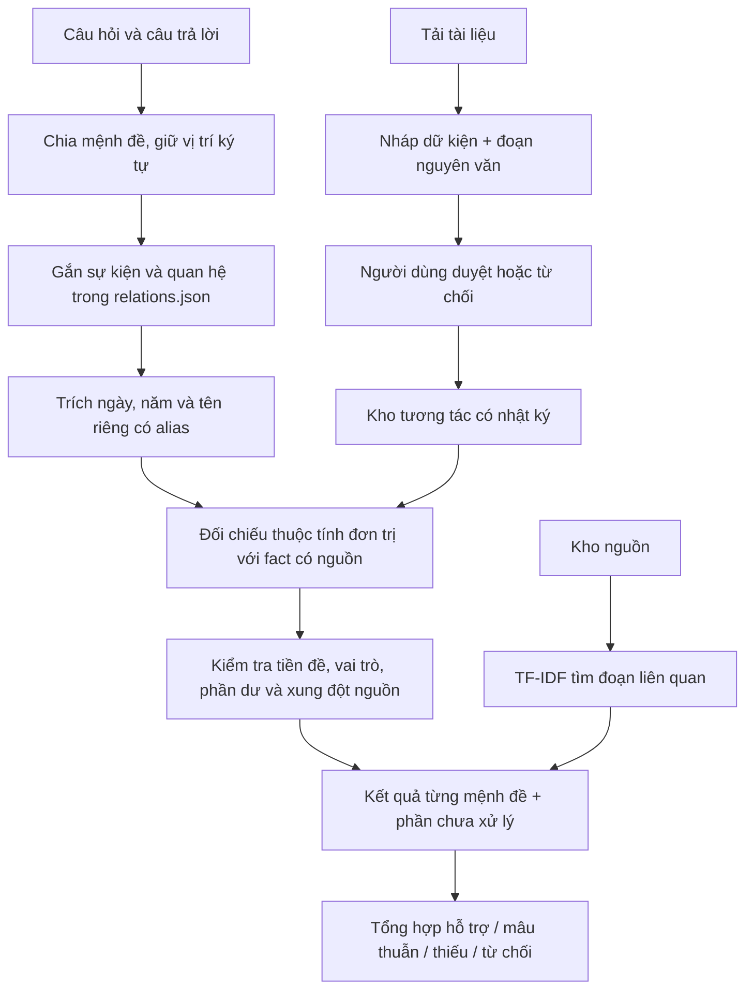

# FactGuard EDU v2: kiểm chứng mệnh đề theo quan hệ và quản lý phần chưa có căn cứ

## Tóm tắt

Phiên bản nghiên cứu chuyển từ đối chiếu một đáp án ngắn sang trích các mệnh đề có cấu trúc trong câu trả lời. Mỗi giá trị được gắn với sự kiện, quan hệ, loại thuộc tính, phạm vi ký tự và dữ kiện nguồn. Khi câu có cả phần đúng và phần sai, các kết quả được hiển thị riêng; nội dung chưa gắn được với quan hệ được giữ lại như phần chưa xử lý.

Đây là một nghiên cứu thực nghiệm phần mềm trên kho đóng, ngữ pháp hữu hạn và dữ liệu tổng hợp. Chưa tiến hành nghiên cứu người học, chưa có giáo viên thẩm định độc lập hoặc chứng minh thuật toán mới ở cấp lĩnh vực. Không sử dụng số liệu người dùng giả.

## 1. Vấn đề nghiên cứu và giả thuyết

**Câu hỏi:** Tách mệnh đề và ràng buộc quan hệ/phạm vi/nguồn có giảm kết luận hỗ trợ sai khi câu trả lời chứa nhiều dữ kiện, so với đối chứng từ vựng ba nhãn và một cấu hình bỏ chốt phạm vi hay không?

- Giả thuyết về khả năng xử lý: bộ trích nhiều mệnh đề có thể đối chiếu ngày, nhân vật và địa điểm trong cùng câu thay vì coi một giá trị đúng là toàn đoạn đúng.
- Giả thuyết về kiểm soát lỗi: chốt tiền đề, vai trò và nội dung dư có thể giảm hỗ trợ sai; đổi lại có thể giảm mức bao phủ kết luận đúng/sai.
- Chưa có giả thuyết được kiểm nghiệm về cải thiện điểm học tập hoặc tư duy phản biện của học sinh.

Các cấu hình, chỉ số và phép lấy mẫu lại đã được ghi trong research_protocol_v2.json trước khi tạo bộ thử thách. Đây là đóng băng cục bộ, không phải đăng ký nghiên cứu công khai hoặc đánh giá độc lập.

## 2. Cơ sở và vị trí đóng góp

FEVER tổ chức bài toán theo nhãn hỗ trợ, bác bỏ, thiếu thông tin, gắn với bằng chứng; nghiên cứu này tham khảo cách tách nhãn và căn cứ, không dùng bộ tiếng Anh đó để so điểm với dữ liệu Việt Nam. [Thorne và cộng sự, 2018](https://aclanthology.org/N18-1074/).

Selective classification nghiên cứu đánh đổi giữa mức bao phủ và rủi ro khi cho phép từ chối. Bản này chỉ đo mức bao phủ/rủi ro quan sát được của các quy tắc; không triển khai bộ hiệu chỉnh hoặc bảo đảm rủi ro xác suất của nghiên cứu mạng nơ-ron. [Geifman và El-Yaniv, 2017](https://arxiv.org/abs/1705.08500).

Đối chứng học máy dùng LogisticRegression trong scikit-learn, với đặc trưng chỉ dựa trên từ vựng và tham số cố định. [Tài liệu chính thức](https://scikit-learn.org/stable/modules/generated/sklearn.linear_model.LogisticRegression.html).

**Đóng góp đã thực hiện ở phạm vi dự án:**

1. Một bộ kiểm chứng có giải thích cho các quan hệ lịch sử được khai báo, đối chiếu nhiều giá trị với nguồn và vị trí ký tự thực trong câu trả lời.
2. Một cơ chế không bỏ qua phần văn bản chưa được xác minh, chặn một số tiền đề và vai trò sai; giữ khả năng từ chối.
3. Luồng quản lý nguồn từ bản nháp tới duyệt/thu hồi có lịch sử phiên bản, không tự chuyển PDF tải lên thành chân lý.
4. Bộ thực nghiệm có đối chứng ba nhãn, ablation, đo lỗi hỗ trợ sai và nguồn bằng chứng, tách dữ liệu tổng hợp với ca người dùng nhập và nhãn tự thẩm định.

Không khẳng định TF-IDF, luật ngày tháng, Logistic Regression, hash chain hoặc ba nhãn là phát minh mới của dự án.

## 3. Mô hình dữ liệu và thuật toán

### 3.1. Ràng buộc quan hệ

Một mệnh đề gồm sự kiện, quan hệ và thuộc tính. Ví dụ `dbp.start/date` và `dbp.end/date` là hai thuộc tính khác nhau: không được dùng ngày kết thúc để hỗ trợ ngày bắt đầu. Có 23 mẫu quan hệ trong data/relations.json, ánh xạ tới 33 dữ kiện nguồn.

Nhận diện cần các nhóm neo, không chỉ một tên sự kiện. Mẫu cụ thể hơn chỉ thay mẫu rộng trong cùng sự kiện; nhiều quan hệ chưa tách được dẫn tới từ chối. Câu ngắn không nêu sự kiện có thể kế thừa một quan hệ duy nhất từ câu hỏi. Câu hỏi có tiền đề sai hoặc địa điểm chưa xác minh được chặn trước khi dùng nó làm ngữ cảnh.

### 3.2. Trích giá trị và giữ dấu vết

Chuẩn hóa có bản đồ vị trí giữa chuỗi bỏ dấu và văn bản gốc. Mỗi check lưu span_start/span_end; cắt văn bản gốc ở đúng khoảng đó cho ra observed. Tên được gom theo tập alias giao nhau có khai báo; không dùng fuzzy để đồng nhất hai nhân vật gần giống tên. Ngày được chuẩn hóa; năm đơn có độ chi tiết khác ngày đầy đủ.

Một câu chứa nhân vật, ngày và nơi có thể sinh ba check, dùng ba fact_id và ba căn cứ. Giá trị đúng/sai hiển thị riêng, không có phần trăm tin cậy tùy ý. Cơ chế vai trò mới chỉ kiểm tra một số mẫu nhân vật/địa điểm theo vị trí từ; chưa phải bộ phân tích ngữ nghĩa tiếng Việt tổng quát.

### 3.3. Phủ định và phần chưa xử lý

Xử lý phủ định đơn trên một thuộc tính đơn trị, ví dụ ‘không phải ngày X mà là ngày Y’. Nếu X là đáp án đúng mà bị phủ định thì có mâu thuẫn; nếu X khác và Y đúng thì hai mệnh đề có thể được hỗ trợ. Phủ định tác động nhiều kiểu thuộc tính vẫn cần người đọc.

Các từ và ý ngoài mẫu sau khi trích giá trị được giữ ở danh sách issues. Có suy đoán, quan hệ thời gian chưa mô hình hóa, câu không gắn được với sự kiện, vai trò đảo hoặc nội dung thêm thì không tự xác nhận toàn đoạn. Nếu có một mệnh đề mâu thuẫn rõ, tổng thể báo mâu thuẫn và vẫn liệt kê phần chưa xử lý. Nếu không có mâu thuẫn nhưng chưa đủ căn cứ, trả insufficient hoặc undetermined.

## 4. Module quản trị nguồn có giá trị sử dụng

Người dùng tải tài liệu → chọn đoạn có thật → lập câu hỏi, đáp án chuẩn, nhóm neo → lưu nháp. Giá trị ngày/tên phải xuất hiện trong đoạn bằng chứng; đáp án hiển thị phải khớp giá trị chuẩn. Nguồn mới chỉ có hiệu lực sau thao tác duyệt có người duyệt, căn cứ và xác nhận đã đọc nguồn.

Mỗi lần duyệt/từ chối/thu hồi lưu phiên bản, thời điểm, bản chụp văn bản và SHA-256. Chuỗi hash cục bộ cùng kiểm tra bản ghi cuối giúp phát hiện thay đổi ngoài luồng; không có xác thực danh tính, chữ ký số hay chống sửa toàn bộ DB. Người duyệt là tự khai, không tự được gọi là giáo viên có chứng nhận.

Thu hồi làm dữ kiện ngừng tham gia kiểm chứng ngay ở lần nạp tiếp theo. Kho do người dùng bổ sung được tách khỏi kho cố định trong thực nghiệm, tránh một lần tải PDF làm đổi điều kiện đo.

## 5. Thiết kế thực nghiệm

### Dữ liệu

- Kho có nguồn: 33 dữ kiện, 7 trang đã đối chiếu trực tuyến; chưa có thẩm định độc lập.
- Development: 24 ca thuộc ba sự kiện của v1, dùng huấn luyện đối chứng ba nhãn. Không dùng nhãn evaluation để fit hoặc chọn tham số.
- Evaluation v1: 87 ca đã được xem trước đó, chỉ giữ làm hồi quy; không gọi là tập chưa biết của v2.
- Challenge v2: 46 ca, 10 cụm sự kiện, 16 supported, 17 contradicted, 13 insufficient. Có 62 mệnh đề giá trị chuẩn và hai ca rút bằng chứng khỏi kho. Tạo sau khi đóng băng mã, nhưng cùng trợ lý thiết kế mã và dữ liệu nên **không độc lập**.
- Ca người dùng: ban đầu chưa có dữ liệu thật. Được nhập riêng, lưu nguồn gốc và thời điểm; không tự điền nhãn.

Các biến thể cùng sự kiện không được coi là quan sát độc lập. Các ca nguồn bị rút dùng cùng kho bị rút cho mọi phương pháp. Chỉ mục đo là các dữ kiện, loại bản tóm lược toàn trang để tránh vô tình vẫn truy xuất sự kiện đã rút qua đoạn tổng quan.

### Bốn cấu hình

| Cấu hình | Thành phần thực sự chạy |
|---|---|
| lexical_3way | TF-IDF ký tự 3–5, sáu đặc trưng từ vựng, StandardScaler + LogisticRegression ba nhãn; C=1, class_weight=balanced; chỉ fit development |
| rules_single_v1 | Giữ nguyên luật một dữ kiện của phiên bản đầu |
| claims_no_guard | Bộ trích mệnh đề v2, bỏ chốt tiền đề/vai trò/nội dung dư; vẫn giữ đối chiếu giá trị và kiểm tra nguồn |
| claims_guarded | Bộ trích và đầy đủ các chốt |

Ablation kiểm tra tác dụng của một nhóm chốt, chưa tách riêng đóng góp từng chốt. Đối chứng được huấn luyện chỉ bằng tập tổng hợp rất nhỏ; không đại diện cho mô hình NLI/LLM mạnh. V1 được thiết kế cho câu hỏi một thuộc tính nên bộ đoạn nhiều dữ kiện/chỉ dẫn chung vượt giao diện đầu vào ban đầu của nó: điểm thấp ở v2 không chứng minh v1 kém ở mọi nhiệm vụ.

### Chỉ số

Accuracy và F1 macro ba nhãn; undetermined vẫn tính sai. Hỗ trợ sai lấy mẫu số là tổng ca không có nhãn supported. Coverage chỉ gồm supported/contradicted; risk là tỷ lệ sai trong các ca đó. Đúng nhãn + đủ bằng chứng yêu cầu các fact_id chuẩn được quy trách nhiệm trực tiếp, không chỉ xuất hiện tình cờ trong top-k.

Đo riêng recall/precision trích giá trị, recall đúng nhãn mệnh đề và recall@4 trước tra cứu có cấu trúc. Không dùng kết quả của bộ trích để tự tạo gold. Thời gian mean/median/p95 đo bằng perf_counter, không gồm dựng giao diện.

Bootstrap cặp theo 10 cụm sự kiện, cùng trọng số mỗi cụm, 2.000 lần, seed cố định. Khoảng 95% có tính thăm dò trên tập tổng hợp được tác giả chọn, không đại diện cho quần thể người học hay mọi sự kiện. Không công bố bảo đảm rủi ro vì chưa quan sát thấy lỗi trên một mẫu nhỏ.

## 6. Kết quả thật và phân tích lỗi

Kết quả chi tiết được tạo bằng code trong [báo cáo đo v2](research_v2/bao_cao_nghien_cuu.md), [CSV](research_v2/results.csv) và [manifest](research_v2/latest.json). Không chép số liệu từ kế hoạch hoặc hình minh họa vào kết quả.

Bốn ca đầy đủ chốt chưa đạt nhãn chuẩn:

- R007: phủ định tác động nhiều thuộc tính, hệ thống từ chối thay vì nhãn contradicted.
- R009/R010: tiền đề sai/chưa xác minh trong câu hỏi; hệ thống từ chối thay vì nhãn insufficient của bộ tác giả.
- R018: vế thứ hai lược chủ ngữ/sự kiện; chưa có bộ giải đồng tham chiếu nên chưa đối chiếu đủ.

Giữ nguyên các ca này sau khi xem điểm, không đổi nhãn để làm đẹp accuracy. Mã lõi và dữ liệu tham chiếu vẫn khớp bản đóng băng.

### Phân tích bổ sung về dạng câu hỏi

Sau khi xem kết quả chính, phát hiện chỉ dẫn chung khác dạng câu hỏi của tập development đối chứng. Vì vậy đã chạy **phân tích hậu nghiệm**: thay chỉ dẫn chung bằng câu hỏi chuẩn ở 34/46 ca phù hợp, giữ đáp án và nhãn. Đối chứng từ vựng tăng từ 17 lên 21 ca đúng, v1 tăng từ 1 lên 13; bản đầy đủ vẫn 42/46. Điều này cho thấy dạng câu hỏi là yếu tố ảnh hưởng đáng kể và phải báo cáo.

Phân tích hậu nghiệm được lưu riêng ở research_v2/format_control, không thay kết quả chính, không gọi là bộ độc lập. Cần bộ dữ liệu do người khác viết và nhiều dạng đầu vào để kết luận chắc hơn.

## 7. Luồng thu thập và gán nhãn thật

Phòng nghiên cứu có phiếu ẩn dự đoán/nhãn tạo sẵn trong màn hình. Người dùng có thể thêm câu trả lời nguyên bản, ghi nguồn gốc, người thu thập và sự kiện. Nhãn được lưu khi người thật nhập, có ghi chú và ID bằng chứng. Độ đồng thuận chỉ tính trên nội dung giống hệt được hai tên khác nhau gán nhãn; kappa để trống khi không xác định.

Ca người dùng chỉ được đưa vào phép đo nhãn đồng thuận sau ít nhất hai tên gán cùng nhãn. Bất đồng hoặc thiếu người được giữ chờ, không tự lấy đa số nhãn máy. Những tên tự khai không chứng minh độc lập/danh tính; cần tổ chức người gán nhãn thật và quy trình riêng nếu muốn công bố nghiên cứu độc lập.

Phép đo ca người dùng chỉ có chuẩn nhãn toàn câu, nên không tự tạo chuẩn mệnh đề/bằng chứng từ đầu ra mô hình. Kết quả này lưu riêng trong runtime, không trộn với challenge tổng hợp. Chưa có dữ liệu người dùng thật tại lúc bàn giao, nên chưa có kết quả thực nghiệm người dùng được công bố.

## 8. Giới hạn và bước tiếp theo

Ngữ pháp hữu hạn, chưa có phân tích quan hệ tổng quát, đồng tham chiếu hoặc phủ định phức tạp. Nguồn nhỏ và có thể còn lỗi; aliases chưa bao phủ cách diễn đạt rộng. Hai mươi ba mẫu quan hệ là kiến thức được biên soạn, không phải mô hình tự học toàn bộ lịch sử. Các ca thực nghiệm có thiên lệch cùng tác giả, đối chứng nhỏ và thiếu nghiên cứu người học.

Ưu tiên tiếp: người hướng dẫn đọc/duyệt nguồn và tổ chức gán nhãn thật; thu bộ mới khác tác giả và kiểu diễn đạt; thêm đối chứng mạnh hơn; tách từng chốt trong ablation; đánh giá mệnh đề có đồng tham chiếu trên tập mới chưa xem. Không đổi thuật toán theo điểm của bộ v2 rồi báo cáo như đánh giá chưa biết.
