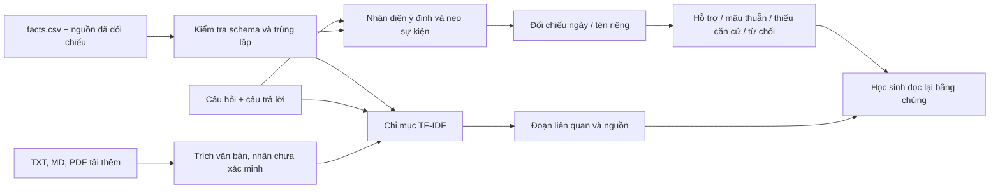

# Phương pháp và báo cáo kỹ thuật

**Tài liệu dưới đây ghi phương pháp v1 được giữ làm đối chứng/hồi quy. Phương pháp hiện hành v2, bộ kiểm chứng nhiều mệnh đề, luồng thẩm định và thiết kế nghiên cứu mới được mô tả trong [nghien_cuu_v2.md](nghien_cuu_v2.md). Kết quả v1 và v2 là hai phép đo khác nhau, không thay thế lẫn nhau.**

## Kiến trúc đã triển khai

`loader.py` đọc/kiểm tra CSV và danh mục nguồn. `retriever.py` lập TF-IDF word unigram/bigram, cosine similarity, trả tối đa 4 đoạn; hòa điểm sắp theo ID. `verifier.py` quyết định bằng dữ kiện có cấu trúc và câu hỏi; không dùng câu trả lời để chọn đáp án tham chiếu. `storage.py` ghi SQLite và uploads cục bộ. `evaluator.py` tính chỉ số, CSV/Markdown/JSON. `ui.py` hiển thị sáu trang bằng Streamlit/Plotly.

## Baseline

Chuẩn hóa chữ thường/bỏ dấu; chọn câu hỏi gần nhất theo RapidFuzz token_set_ratio. Nếu điểm câu hỏi và điểm khớp đáp án đều từ 65, dự đoán supported; còn lại insufficient. Không có quy tắc ngày/tên, phủ định hay mâu thuẫn, vì vậy không dự đoán contradicted. Đây là một baseline từ vựng đơn giản và yếu, chưa đủ để so sánh với mọi phương pháp kiểm chứng hiện có. Cùng kho đáp án và cùng tập kiểm thử được dùng cho cả hai phương pháp.

Ngưỡng 65 là hằng số heuristics trong thiết kế trước khi chạy thực nghiệm, không phải xác suất đúng. Không có bước tối ưu ngưỡng theo evaluation.

## Phương pháp đề xuất

1. Tìm đoạn gần câu hỏi bằng TF-IDF để học sinh đọc. Một nhánh tra cứu có cấu trúc nhận diện loại câu hỏi và các nhóm neo (ví dụ Điện Biên Phủ + kết thúc).
2. Cần khớp ít nhất một biến thể trong mỗi nhóm neo và loại thuộc tính được hỏi. Không tìm được dữ kiện chuẩn: insufficient. Câu hỏi mở hoặc nhiều dữ kiện có thể phù hợp: undetermined.
3. Chỉ dùng dữ kiện đã đối chiếu nguồn. Không tự coi tài liệu tải thêm là một đáp án chuẩn.
4. Chuẩn hóa dd/mm/yyyy, dd-mm-yyyy, dd.mm.yyyy và ‘ngày d tháng m năm yyyy’. Câu hỏi năm có thể đối chiếu năm. Đúng năm nhưng thiếu ngày/tháng khi hỏi ngày: insufficient. Sai năm rõ ràng có thể kết luận mâu thuẫn.
5. Tên riêng khớp aliases đã biên soạn; tên thay thế được nhận diện từ các dữ kiện cùng kiểu trong kho. Tên lạ không tự bị coi là sai. Địa danh bao chứa chưa đủ cụ thể không tự bị coi là mâu thuẫn.
6. Phủ định, nhiều mốc, câu nhiều ý hoặc quá 32 từ thường được từ chối. Sau khi trích giá trị, phần còn lại chỉ được chứa từ của câu hỏi và từ nối đơn giản. Có giá trị đúng kèm nội dung lạ: chưa hỗ trợ toàn câu, trả undetermined.
7. Luôn hiển thị dữ kiện dùng quyết định, đoạn bằng chứng và vị trí nguồn. Điểm cosine không tham gia như một xác suất đúng.

Đây là quy tắc từ vựng cho câu trả lời ngắn, chưa có phân tích ngữ nghĩa/quan hệ tổng quát. Thứ tự từ và tiền đề sai trong câu hỏi có thể là nguồn lỗi; cần giới hạn rõ khi trình diễn. Không tự động tách và xác minh hết mọi mệnh đề trong một đoạn tự do.

## Dữ liệu và kiểm soát chất lượng

33 dữ kiện từ 7 URL đã mở/đối chiếu ngày 24/10/2026, với tóm lược tự viết ngắn và vị trí đoạn/trường. Nhãn verified ghi nhận thao tác đối chiếu trực tuyến của trợ lý; chưa đại diện cho hội đồng chuyên gia thẩm định.

111 ca (24 development, 87 evaluation), gồm đúng/sai mốc thời gian, đúng/nhầm nhân vật/địa danh, thiếu thông tin, ngoài tài liệu, biến thể cách viết và phủ định. 87 ca đánh giá gồm 29 câu hỏi phân biệt; không coi 87 ca là 87 quan sát độc lập về người học. Tách theo sự kiện, không trộn các biến thể cùng sự kiện vào hai tập. Kho tri thức có sẵn đáp án sự kiện đánh giá, đúng với nhiệm vụ đối chiếu kho đóng.

Ca ngoài kho có thể chứa kiến thức đúng trên thực tế nhưng vẫn nhãn insufficient vì không có bằng chứng trong kho. Với câu có ý thêm không được hỗ trợ, nhãn chuẩn insufficient. Với phủ định đáp án đúng, nhãn chuẩn contradicted; chương trình có thể trả undetermined và sẽ bị tính sai. Chính sách nhãn này được công bố để tránh che giấu lỗi bằng cách đổi nhãn sau thực nghiệm.

## Chỉ số

- Accuracy = số dự đoán đúng nhãn / toàn bộ ca.
- Precision của nhãn = TP/(TP+FP); Recall = TP/(TP+FN); F1 = trung bình điều hòa Precision và Recall. Mẫu số 0 ghi 0.
- Macro lấy trung bình đều ba nhãn chuẩn, kể cả khi hệ thống không dự đoán một nhãn.
- Confusion matrix bốn cột đầu ra; hàng undetermined bằng 0 vì không dùng làm nhãn chuẩn.
- Tỷ lệ từ chối tự kết luận = undetermined/n.
- Tỷ lệ chưa kết luận đúng/sai = (insufficient + undetermined)/n; insufficient là một kết quả có ý nghĩa trong bài toán thiếu bằng chứng.
- Thời gian từng lời gọi đo perf_counter; ghi mean, median, p95. Không gồm khởi tạo chỉ mục/giao diện, không suy rộng sang phần cứng khác.
- selective_accuracy trong JSON chỉ loại nhãn từ chối undetermined, vẫn giữ insufficient; không được mô tả là tỷ lệ đúng trên mọi câu có kết luận đúng/sai.

## Tái lập và tính trung thực

Không dùng ngẫu nhiên. scripts/reproduce.py chạy hai lần và so dự đoán, không đòi thời gian bằng nhau. JSON lưu Python, thư viện, hệ điều hành và SHA-256 dữ liệu. reports/protocol.json ghi quy tắc/ngưỡng. Sửa lỗi phần mềm được phát hiện bằng unit test được ghi trong nhật ký; không tối ưu theo điểm evaluation.

Kết quả thực tế nằm trong [báo cáo thực nghiệm](experiment/ket_qua_thuc_nghiem.md). Chưa có kiểm định thống kê cho dữ liệu phụ thuộc, chưa so với baseline truy xuất ngữ nghĩa mạnh hơn, chưa thử nghiệm học sinh. Không khẳng định tính mới ở cấp công trình khoa học nếu chưa khảo sát tài liệu liên quan đầy đủ.
